# Phát hiện leo thang đặc quyền trên Linux bằng Wazuh

> **Phạm vi sử dụng:** Nội dung được xây dựng cho môi trường lab cô lập phục vụ đào tạo SOC, Threat Hunting và Purple Team. Không thực hiện các lệnh tấn công trên hệ thống không thuộc quyền quản lý hoặc chưa được cấp phép.


Leo thang đặc quyền là một trong những bước nguy hiểm nhất sau khi kẻ tấn công đã có quyền truy cập ban đầu. Trong bài lab này, một tài khoản Linux thông thường được cấp sai quyền `sudo` đối với binary `find`. Chỉ từ một cấu hình tưởng như nhỏ, người dùng có thể mở shell với quyền `root`, đọc dữ liệu nhạy cảm, tạo tài khoản backdoor và thực hiện các hành vi hậu khai thác.

Bài thực hành không chỉ dừng ở việc mô phỏng tấn công. Trọng tâm quan trọng hơn là quan sát dấu vết trong `auth.log`, kiểm tra cảnh báo trên Wazuh, xây dựng custom rule và thực hiện quy trình ứng phó theo hướng bảo toàn bằng chứng trước khi loại bỏ nguyên nhân.

## Mục tiêu bài lab

Sau khi hoàn thành bài lab, người học có thể:

- Nhận diện rủi ro từ cấu hình `sudoers` sai.
- Theo dõi phiên đăng nhập SSH và phiên đặc quyền PAM.
- Phân tích hành vi `sudo find` mở shell `root`.
- Xây dựng Wazuh Rule 110400 ánh xạ MITRE ATT&CK T1548.003.
- Thực hiện containment, eradication, recovery và giám sát sau khôi phục.

## Kiến trúc hạ tầng


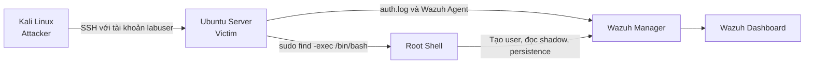

Môi trường gồm Kali Linux làm máy tấn công, Ubuntu Server làm máy nạn nhân và Wazuh làm hệ thống giám sát. Ubuntu cài Wazuh Agent để gửi log xác thực về Wazuh Manager.

## Cấu hình sai tạo ra lỗ hổng

Tài khoản `labuser` được phép chạy `/usr/bin/find` dưới quyền root mà không cần mật khẩu:

```bash
sudo visudo
```

Thêm cấu hình:

```text
labuser ALL=(ALL) NOPASSWD: /usr/bin/find
```

Vấn đề không nằm ở bản thân chương trình `find`, mà ở khả năng thực thi lệnh khác thông qua tham số `-exec`. Khi binary này chạy với quyền root, lệnh con cũng được thực thi với quyền root.

## Chuỗi tấn công mô phỏng

Kẻ tấn công đăng nhập vào Ubuntu qua SSH:

```bash
ssh labuser@IP_VICTIM
whoami
```

Kiểm tra quyền sudo:

```bash
sudo -l
```

Khai thác cấu hình sai để mở shell root:

```bash
sudo find . -exec /bin/bash \; -quit
whoami
```

Kết quả mong đợi là `root`. Sau đó, một số hành vi hậu khai thác được thực hiện nhằm tạo dấu vết phục vụ điều tra:

```bash
cat /etc/shadow
id
uname -a
useradd -m attacker1
id attacker1
```

Chuỗi hành vi đáng chú ý là: tài khoản thường đăng nhập SSH, thực thi `sudo`, mở phiên PAM cho root, đọc tệp nhạy cảm và tạo tài khoản mới.

## Phát hiện trên Wazuh

Wazuh có thể ghi nhận các sự kiện nền như:

- Rule 5402: thực thi lệnh sudo thành công.
- Rule 5501 và 5502: mở và đóng phiên đặc quyền.
- Rule 5902 và 5901: tạo tài khoản và nhóm mới.

Tuy nhiên, các rule mặc định chưa nhất thiết phân biệt được một lệnh `find` hợp lệ với hành vi lợi dụng `find` để sinh shell. Vì vậy, bài lab xây dựng custom rule chuyên biệt:

```xml
<group name="local,linux,privilege_escalation,sudo_abuse,">
  <rule id="110400" level="12">
    <if_sid>5402,5403</if_sid>
    <match type="pcre2">(?i)USER=root.*COMMAND=/usr/bin/find.*-exec.*/bin/(bash|sh)</match>
    <description>Phat hien tai khoan loi dung sudo find de mo shell quyen root.</description>
    <mitre>
      <id>T1548.003</id>
    </mitre>
    <group>privilege_escalation,sudo_abuse,suspicious_shell,</group>
  </rule>
</group>
```


Rule 110400 được đặt mức 12 vì hành vi cho thấy tài khoản thường đã có khả năng chuyển sang quyền root. Giá trị của rule nằm ở việc đối chiếu trực tiếp command line thay vì chỉ cảnh báo mọi hoạt động `sudo`.

## Điều tra Blue Team

Trên SIEM, có thể truy vấn theo hoạt động sudo hoặc tài khoản:

```text
event.action: sudo
```

```text
process.name: sudo AND user.name: labuser
```

Trên endpoint Linux, kiểm tra log xác thực:

```bash
grep sudo /var/log/auth.log
grep "session opened" /var/log/auth.log
history
```

SOC Analyst cần dựng lại timeline:

1. Địa chỉ IP nào đăng nhập SSH?
2. `labuser` đăng nhập lúc nào?
3. Lệnh sudo nào đã được chạy?
4. Phiên root được mở vào thời điểm nào?
5. Sau khi có root, tài khoản, cronjob, service hoặc SSH key nào được tạo?
6. Có thay đổi nào trong `/etc`, `/root` và `/home`?

Không nên chỉ dựa vào shell history vì attacker có thể xóa hoặc sửa lịch sử. Cần đối chiếu `auth.log`, Wazuh alert, thông tin phiên đăng nhập, tiến trình và kết nối mạng.

## Ứng phó sự cố

Bước đầu tiên là bảo toàn bằng chứng:

```bash
sudo mkdir -p /var/ir/evidence
sudo chmod 700 /var/ir/evidence
sudo cp --preserve=timestamps /var/log/auth.log /var/ir/evidence/auth.log
sudo cp -a /etc/sudoers /var/ir/evidence/
sudo cp -a /etc/sudoers.d /var/ir/evidence/
sudo last -ai > /var/ir/evidence/last-login.txt
sudo ps auxf > /var/ir/evidence/processes.txt
sudo ss -plant > /var/ir/evidence/network-connections.txt
sudo who > /var/ir/evidence/current-sessions.txt
```

Tạo mã băm cho bằng chứng:

```bash
sudo sh -c 'find /var/ir/evidence -type f -exec sha256sum {} \; > /var/ir/evidence/SHA256SUMS.txt'
```

Sau đó mới containment:

```bash
sudo passwd -l labuser
sudo pkill -u labuser
sudo ufw deny from <IP_nguon_tan_cong>
```

Loại bỏ cấu hình sai và kiểm tra lại:

```bash
sudo rm -f /etc/sudoers.d/lab-find
sudo visudo -c
sudo -l -U labuser
```

Nếu tài khoản `attacker1` là thay đổi trái phép:

```bash
getent passwd attacker1
id attacker1
sudo userdel -r attacker1
```

## Bài học rút ra

Một dòng cấu hình `NOPASSWD` có thể trở thành đường dẫn trực tiếp tới root. Phòng thủ hiệu quả cần kết hợp ba lớp: nguyên tắc least privilege, log đầy đủ trên endpoint và rule phát hiện theo ngữ cảnh command line. Sau khi attacker đã có root, việc chỉ xóa user hoặc sửa `sudoers` chưa đủ để kết luận hệ thống sạch; cần rà soát persistence hoặc khôi phục từ snapshot tin cậy nếu không thể xác định đầy đủ thay đổi.

---

## Toàn bộ hình ảnh từ tài liệu gốc

Phần dưới đây tập hợp **19 hình ảnh** được trích xuất từ tài liệu gốc cho Lab 1 – Privilege Escalation trên Linux. Thứ tự hình được giữ theo trình tự xuất hiện trong tài liệu.

### Hình 1 – Minh họa Lab 1 – Privilege Escalation trên Linux

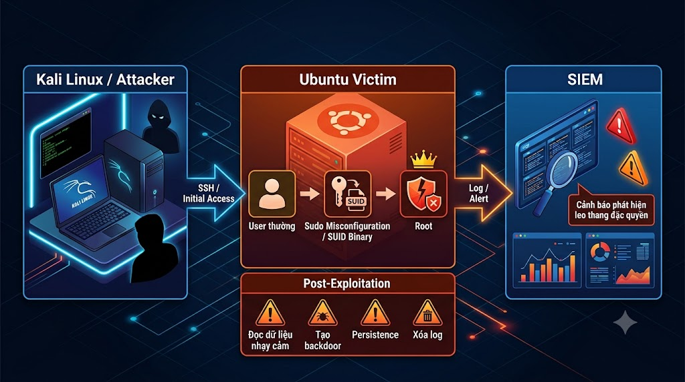

### Hình 2 – Minh họa Lab 1 – Privilege Escalation trên Linux

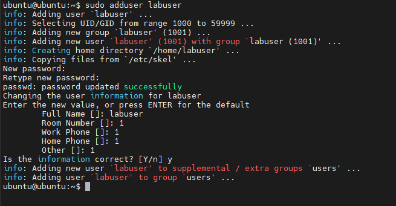

### Hình 3 – Minh họa Lab 1 – Privilege Escalation trên Linux

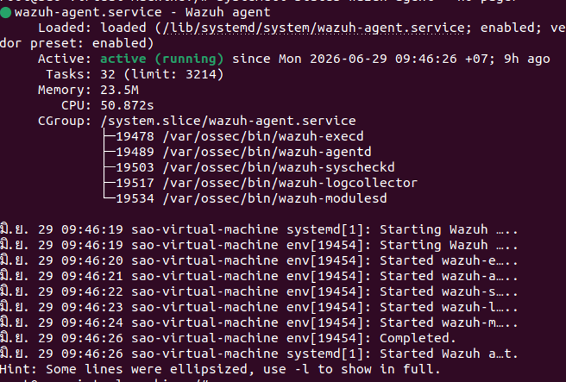

### Hình 4 – Minh họa Lab 1 – Privilege Escalation trên Linux

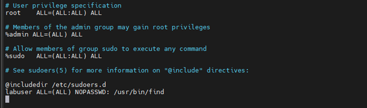

### Hình 5 – Minh họa Lab 1 – Privilege Escalation trên Linux

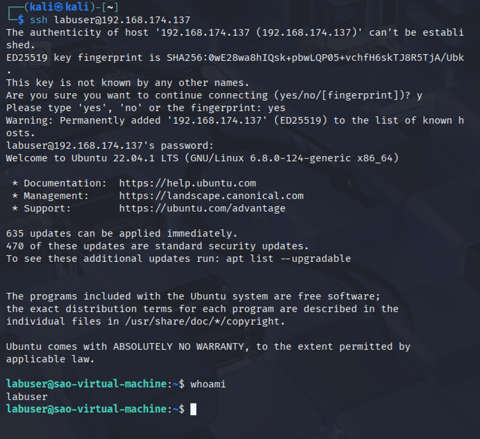

### Hình 6 – Minh họa Lab 1 – Privilege Escalation trên Linux

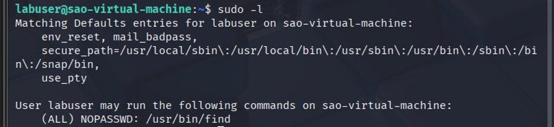

### Hình 7 – Minh họa Lab 1 – Privilege Escalation trên Linux

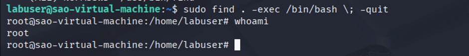

### Hình 8 – Minh họa Lab 1 – Privilege Escalation trên Linux

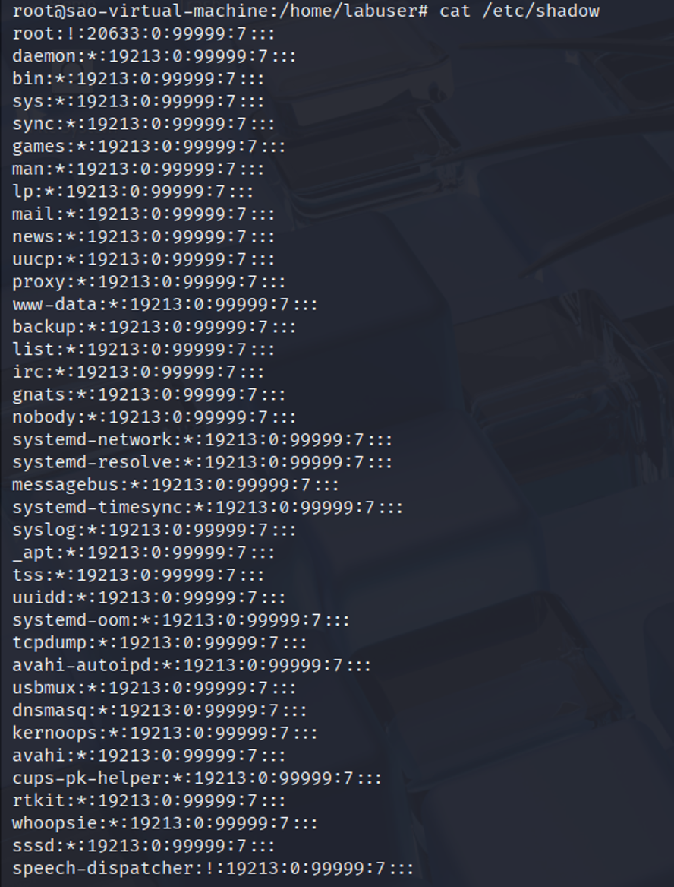

### Hình 9 – Minh họa Lab 1 – Privilege Escalation trên Linux

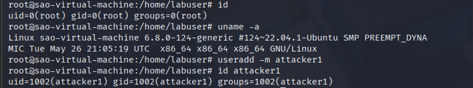

### Hình 10 – Minh họa Lab 1 – Privilege Escalation trên Linux

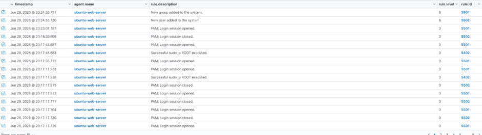

### Hình 11 – Minh họa Lab 1 – Privilege Escalation trên Linux

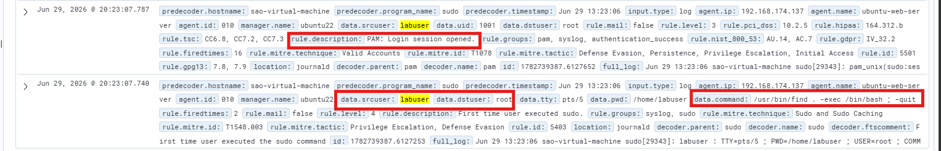

### Hình 12 – Minh họa Lab 1 – Privilege Escalation trên Linux


### Hình 13 – Minh họa Lab 1 – Privilege Escalation trên Linux

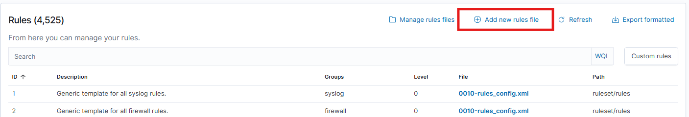

### Hình 14 – Minh họa Lab 1 – Privilege Escalation trên Linux

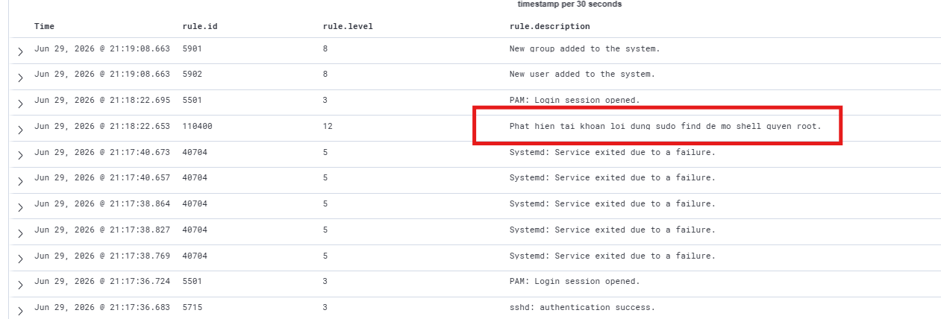

### Hình 15 – Minh họa Lab 1 – Privilege Escalation trên Linux

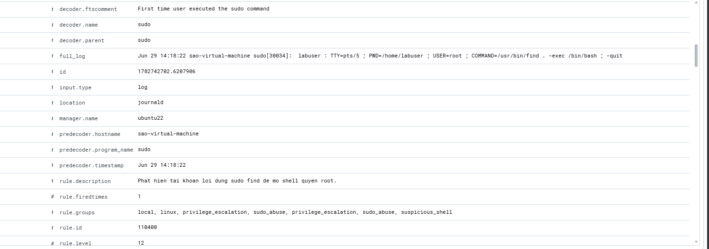

### Hình 16 – Minh họa Lab 1 – Privilege Escalation trên Linux

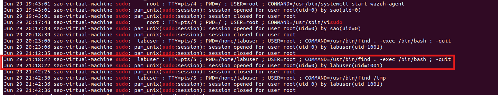

### Hình 17 – Minh họa Lab 1 – Privilege Escalation trên Linux

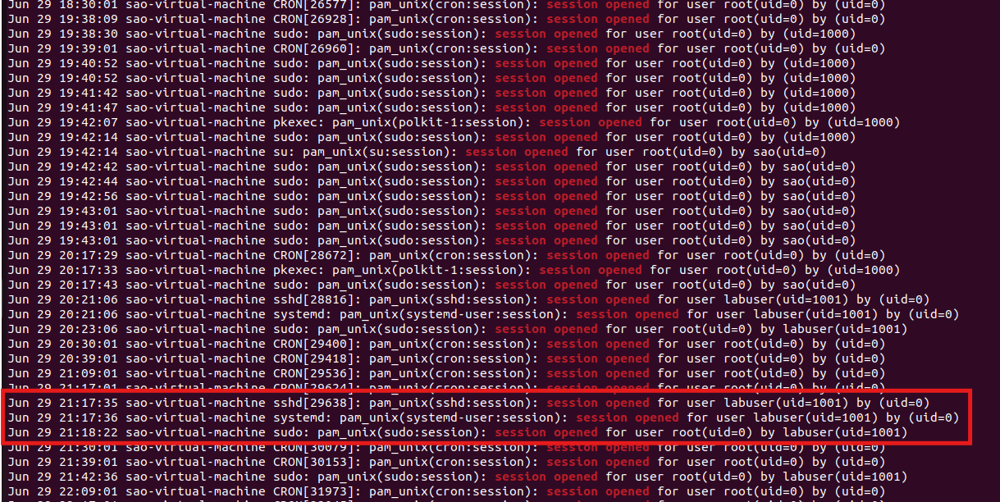

### Hình 18 – Minh họa Lab 1 – Privilege Escalation trên Linux

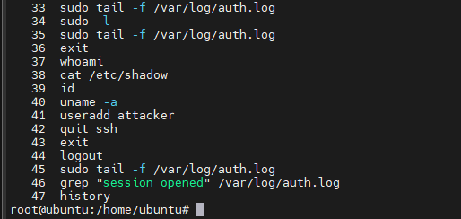

### Thông tin liên hệ/ghi chú cuối phần – Lab 1 – Privilege Escalation trên Linux

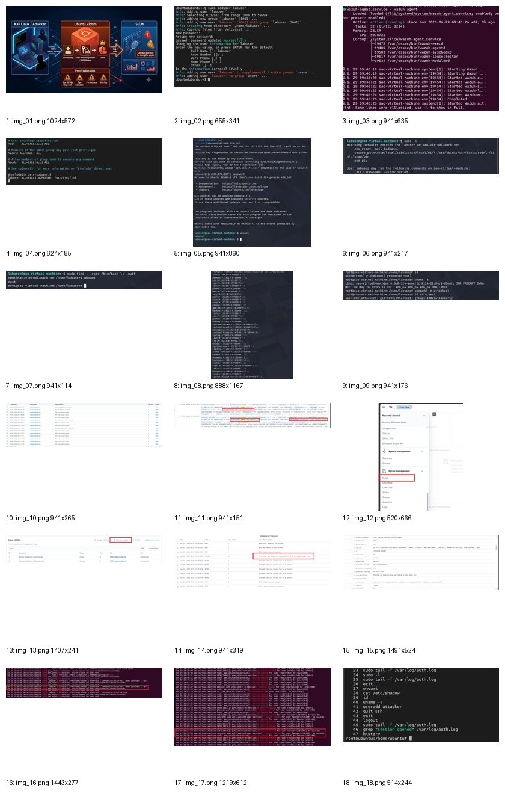
