# Phát hiện Brute Force SSH và RDP bằng Wazuh

> **Phạm vi sử dụng:** Nội dung được xây dựng cho môi trường lab cô lập phục vụ đào tạo SOC, Threat Hunting và Purple Team. Không thực hiện các lệnh tấn công trên hệ thống không thuộc quyền quản lý hoặc chưa được cấp phép.


Brute Force là kỹ thuật đơn giản nhưng vẫn hiệu quả khi dịch vụ quản trị từ xa được mở ra mạng và tài khoản sử dụng mật khẩu yếu. Bài lab mô phỏng Hydra gửi nhiều lần đăng nhập tới SSH trên Ubuntu và RDP trên Windows Server. Wazuh Agent thu thập log xác thực từ hai hệ điều hành, sau đó Wazuh Manager phân tích và sinh cảnh báo.

## Kiến trúc hạ tầng

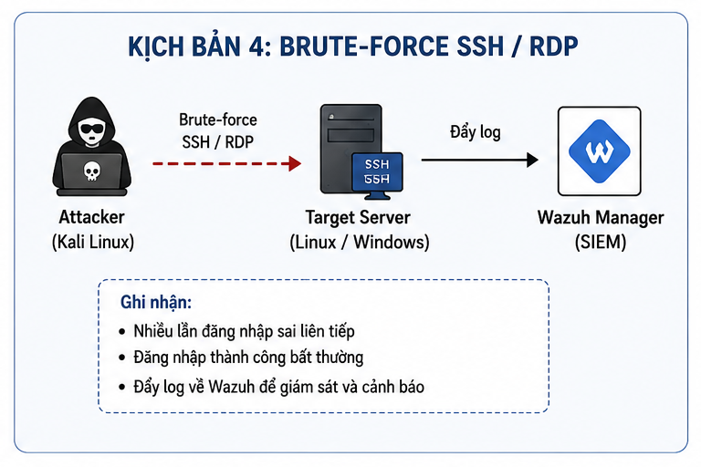

| Thiết bị | Vai trò | Địa chỉ IP |
|---|---|---|
| Kali Linux | Máy tấn công | 192.168.174.132 |
| Ubuntu Server | SSH Server + Wazuh Agent | 192.168.174.131 |
| Windows Server | RDP Server + Wazuh Agent | 192.168.174.129 |
| Wazuh Server | SIEM | 192.168.174.25 |

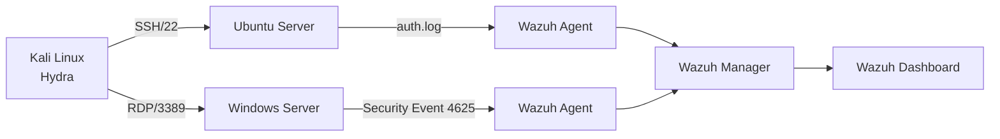

## Chuẩn bị giám sát

Trên Wazuh Server:

```bash
systemctl status wazuh-manager
systemctl status wazuh-dashboard
systemctl status wazuh-indexer
/var/ossec/bin/agent_control -l
```

Trên Ubuntu:

```bash
sudo systemctl status ssh
ss -tunlp | grep 22
tail -f /var/log/auth.log
```

Trên Windows Server, bật Remote Desktop và kiểm tra firewall:

```powershell
Get-NetFirewallRule -DisplayGroup "Remote Desktop"
```

Điều kiện quan trọng nhất là hai agent phải ở trạng thái `Active`, nếu không Wazuh Dashboard sẽ không có dữ liệu để tương quan.

## Mô phỏng tấn công RDP

```bash
hydra -t 1 -W 3   -l Administrator   -P /usr/share/wordlists/rockyou.txt   rdp://192.168.174.129
```

Trên Windows Event Viewer:

```text
Windows Logs -> Security -> Event ID 4625
```

Event ID 4625 biểu thị đăng nhập thất bại. SOC Analyst cần xem `TargetUserName`, `IpAddress`, `LogonType` và số lượng sự kiện trong một khoảng thời gian ngắn.

## Mô phỏng tấn công SSH

```bash
hydra   -l ubuntu   -P /usr/share/wordlists/rockyou.txt   ssh://192.168.174.131
```

Theo dõi log:

```bash
tail -f /var/log/auth.log
grep "Failed password" /var/log/auth.log
```

Các dòng `Failed password` lặp lại từ cùng một IP là bằng chứng rõ ràng của password guessing.

## Truy vấn trên Wazuh

Ví dụ lọc Windows:

```text
data.win.system.eventID:4625
```

Lọc địa chỉ IP nguồn:

```text
data.srcip:192.168.174.132
```

Với SSH, kiểm tra rule nền liên quan đến đăng nhập thất bại và brute force. Điều quan trọng không chỉ là số lượng alert, mà còn phải xác định tài khoản mục tiêu, nguồn tấn công, khoảng thời gian và có lần đăng nhập thành công nào xuất hiện sau chuỗi thất bại hay không.

## Custom rule

```xml
<group name="local,custom_bruteforce,">
  <rule id="100600" level="15">
    <if_sid>5763</if_sid>
    <description>[CUSTOM] Critical SSH Brute Force Attack Detected</description>
    <group>ssh,bruteforce,attack,custom,</group>
    <mitre>
      <id>T1110</id>
    </mitre>
  </rule>

  <rule id="100601" level="16">
    <if_sid>5760</if_sid>
    <match>root</match>
    <description>[CUSTOM] SSH Root Account Brute Force</description>
    <group>ssh,root,attack,custom,</group>
  </rule>

  <rule id="100602" level="15">
    <if_sid>60204</if_sid>
    <description>[CUSTOM] Critical Windows RDP Brute Force</description>
    <group>windows,rdp,bruteforce,custom,</group>
    <mitre>
      <id>T1110</id>
    </mitre>
  </rule>

  <rule id="100603" level="13">
    <if_sid>60122</if_sid>
    <field name="win.eventdata.targetUserName">Administrator</field>
    <description>[CUSTOM] Administrator Login Failure</description>
    <group>windows,administrator,custom,</group>
  </rule>
</group>
```

Kiểm tra và khởi động lại:

```bash
/var/ossec/bin/wazuh-analysisd -t
systemctl restart wazuh-manager
```


## Điều tra Blue Team

Một cuộc điều tra đầy đủ cần trả lời:

- IP nào tạo ra nhiều lần thất bại?
- Tài khoản nào bị nhắm đến?
- SSH, RDP hay cả hai?
- Có đăng nhập thành công sau chuỗi thất bại không?
- Tài khoản có quyền cao như `root` hoặc `Administrator` không?
- IP nguồn có tấn công nhiều máy chủ khác không?

Nếu xuất hiện đăng nhập thành công, sự cố không còn là brute force đơn thuần mà phải được xử lý như account compromise.

## Xử lý sự cố

Trên Ubuntu, chặn IP:

```bash
sudo iptables -A INPUT -s 192.168.174.132 -j DROP
```

Hoặc:

```bash
sudo ufw deny from 192.168.174.132
```

Khóa tài khoản khi cần:

```bash
sudo passwd -l root
```

Trên Windows:

```powershell
New-NetFirewallRule `
  -DisplayName "Block Attacker" `
  -Direction Inbound `
  -RemoteAddress 192.168.174.132 `
  -Action Block
```

Có thể disable tài khoản Administrator trong `Computer Management` nếu phù hợp với kịch bản lab. Sau xử lý, chạy lại Hydra để xác nhận kết nối đã bị chặn và kiểm tra Dashboard không còn phát sinh đăng nhập thành công.

## Bài học rút ra

Brute Force dễ phát hiện khi log đầy đủ, nhưng cần nâng mức ưu tiên theo tài khoản, dịch vụ và ngưỡng thời gian. Tấn công vào `root` hoặc `Administrator` phải nghiêm trọng hơn tài khoản thông thường. Custom rule giúp SOC chuyển từ hàng loạt event thất bại sang cảnh báo có ngữ cảnh và có thể hành động.

---

## Toàn bộ hình ảnh từ tài liệu gốc

Phần dưới đây tập hợp **16 hình ảnh** được trích xuất từ tài liệu gốc cho Lab 4 – Brute Force SSH/RDP. Thứ tự hình được giữ theo trình tự xuất hiện trong tài liệu.

### Hình 1 – Minh họa Lab 4 – Brute Force SSH/RDP


### Hình 2 – Minh họa Lab 4 – Brute Force SSH/RDP

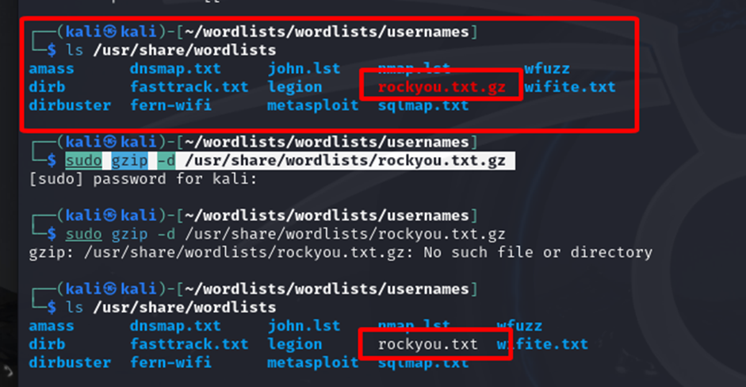

### Hình 3 – Minh họa Lab 4 – Brute Force SSH/RDP

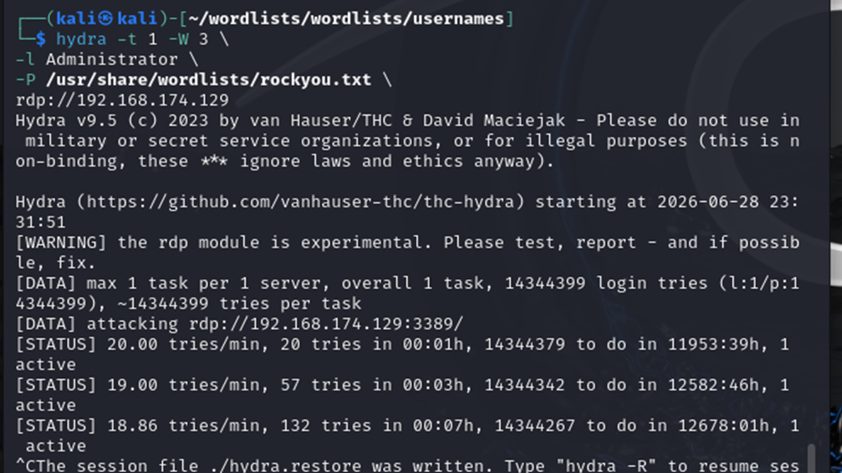

### Hình 4 – Minh họa Lab 4 – Brute Force SSH/RDP

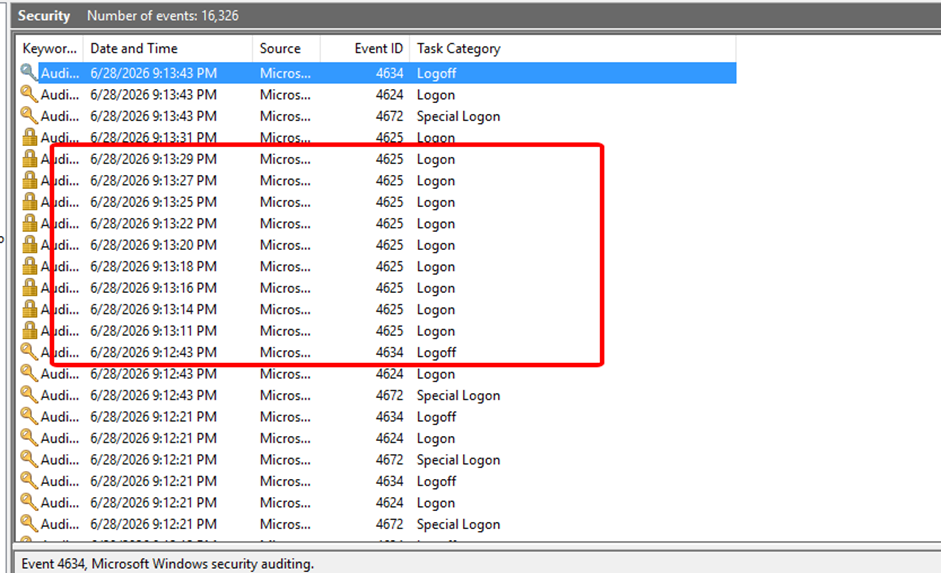

### Hình 5 – Minh họa Lab 4 – Brute Force SSH/RDP

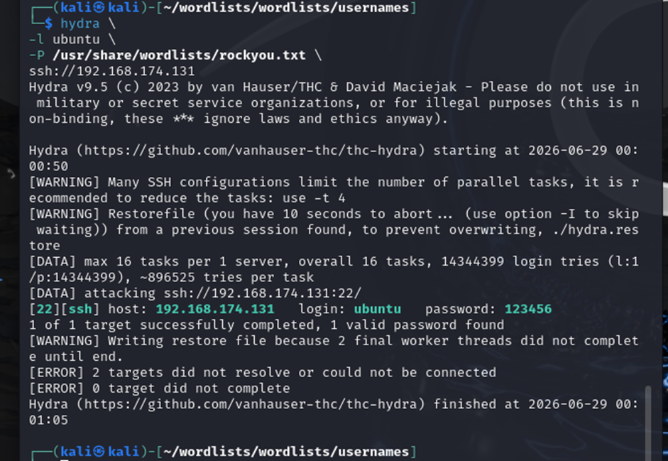

### Hình 6 – Minh họa Lab 4 – Brute Force SSH/RDP

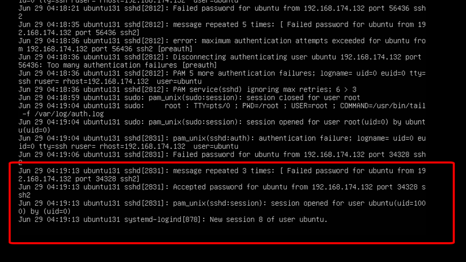

### Hình 7 – Minh họa Lab 4 – Brute Force SSH/RDP

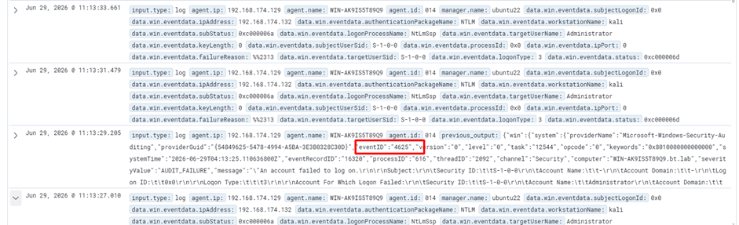

### Hình 8 – Minh họa Lab 4 – Brute Force SSH/RDP

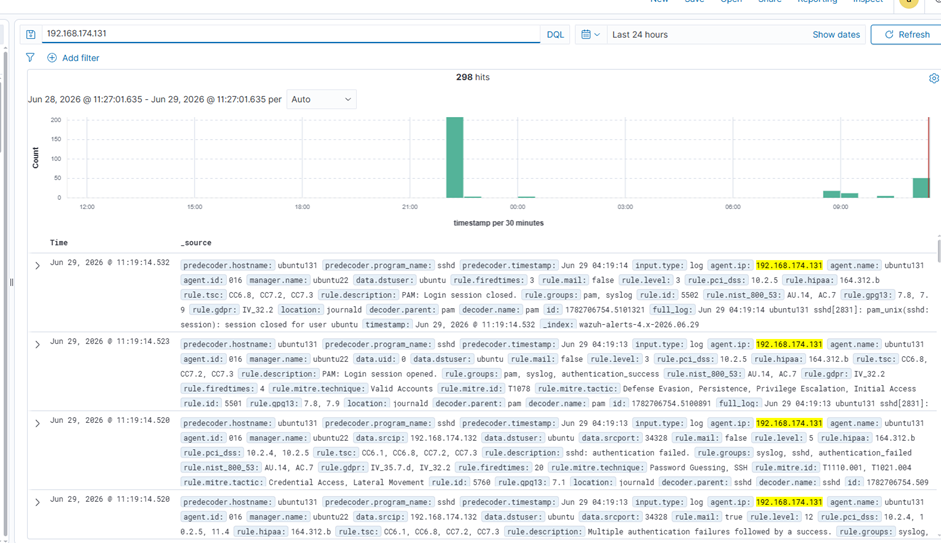

### Hình 9 – Minh họa Lab 4 – Brute Force SSH/RDP

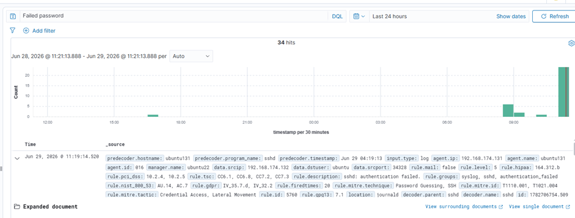

### Hình 10 – Minh họa Lab 4 – Brute Force SSH/RDP

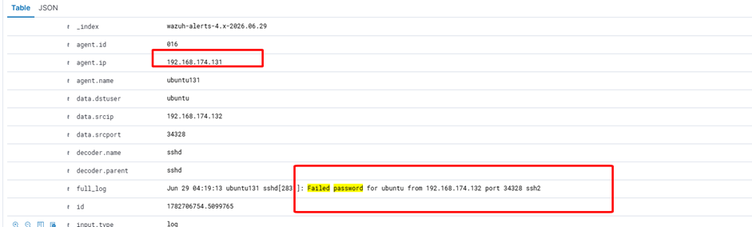

### Hình 11 – Minh họa Lab 4 – Brute Force SSH/RDP

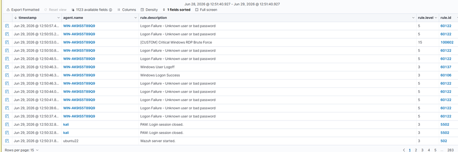

### Hình 12 – Minh họa Lab 4 – Brute Force SSH/RDP

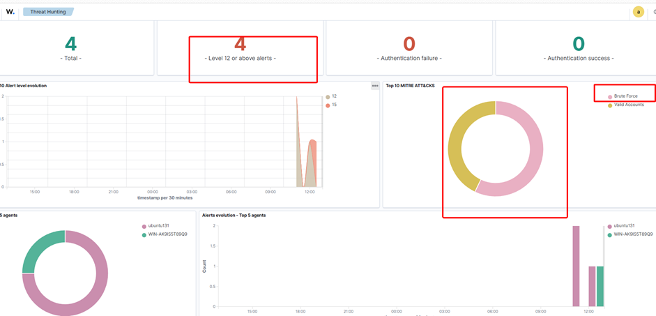

### Hình 13 – Minh họa Lab 4 – Brute Force SSH/RDP

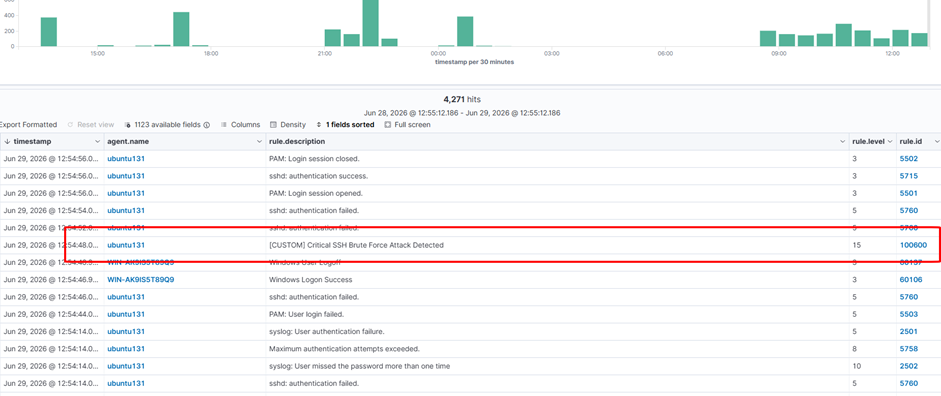

### Hình 14 – Minh họa Lab 4 – Brute Force SSH/RDP

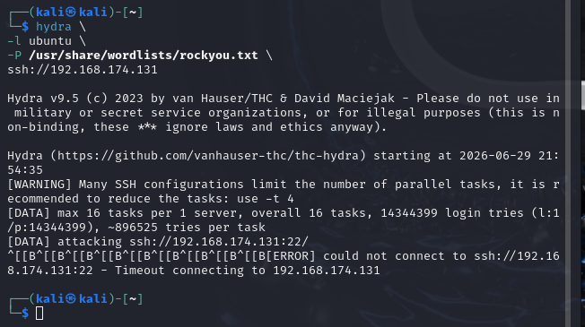

### Hình 15 – Minh họa Lab 4 – Brute Force SSH/RDP

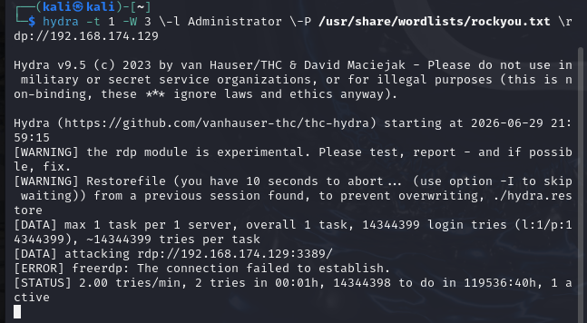

### Thông tin liên hệ/ghi chú cuối phần – Lab 4 – Brute Force SSH/RDP

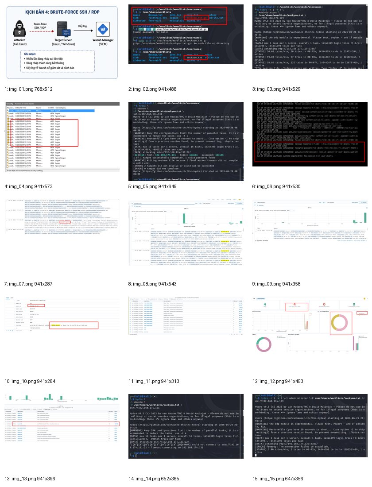
