# Phát hiện Network Scanning và Reconnaissance

> **Phạm vi sử dụng:** Nội dung được xây dựng cho môi trường lab cô lập phục vụ đào tạo SOC, Threat Hunting và Purple Team. Không thực hiện các lệnh tấn công trên hệ thống không thuộc quyền quản lý hoặc chưa được cấp phép.


Reconnaissance là bước chuẩn bị giúp attacker lập bản đồ mạng, xác định host đang hoạt động, cổng mở, phiên bản dịch vụ và lỗ hổng tiềm năng. Bài lab sử dụng Nmap từ Kali Linux để quét Windows Server, trong khi Windows Filtering Platform, Windows Firewall log và Wazuh cung cấp telemetry cho Blue Team.

## Kiến trúc hạ tầng

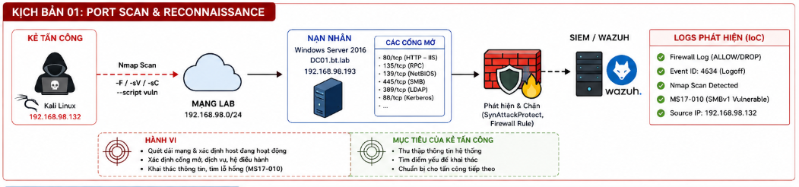

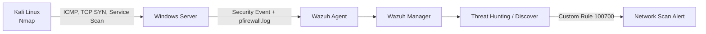

## Bật audit và thu thập firewall log

Trên Windows Server:

```powershell
auditpol /set /subcategory:"Filtering Platform Packet Drop" /failure:enable
auditpol /set /subcategory:"Filtering Platform Connection" `
  /success:enable /failure:enable
```

Kiểm tra:

```powershell
auditpol /get /subcategory:"Filtering Platform Packet Drop"
auditpol /get /subcategory:"Filtering Platform Connection"
```

Thêm nguồn log vào Wazuh Agent:

```xml
<localfile>
  <location>Security</location>
  <log_format>eventchannel</log_format>
</localfile>

<localfile>
  <location>C:\Windows\System32\LogFiles\Firewall\pfirewall.log</location>
  <log_format>syslog</log_format>
</localfile>
```

Khởi động lại agent:

```powershell
Restart-Service WazuhSvc
```

Kiểm tra:

```powershell
Get-Content "C:\Program Files (x86)\ossec-agent\ossec.log" -Tail 40
```

Cần thấy agent kết nối tới server và phân tích `pfirewall.log`.

## Giai đoạn 1 - Host discovery và fast scan

```bash
nmap -F 192.168.98.0/24
```

Fast scan giúp attacker nhanh chóng xác định host và các cổng phổ biến. Dấu vết thường là nhiều kết nối ngắn tới nhiều port hoặc nhiều host trong khoảng thời gian ngắn.

## Giai đoạn 2 - Service và script scan

```bash
nmap -sV -sC 192.168.98.193
```

Kết quả trong tài liệu tiết lộ:

- Windows Server 2016 Standard Evaluation.
- Domain `bt.lab`.
- FQDN `DC01.bt.lab`.
- IIS 10.0 trên cổng 80.
- SMB trên cổng 445.

Đây là ví dụ rõ ràng về information leakage. Chỉ bằng quét dịch vụ, attacker đã có dữ liệu để lựa chọn kỹ thuật tiếp theo.

## Giai đoạn 3 - Kiểm tra lỗ hổng

```bash
nmap --script vuln 192.168.98.193
```

Kết quả bài lab ghi nhận MS17-010/EternalBlue liên quan tới SMBv1 chưa được vá. Đồng thời, quá trình quét xuất hiện `Connection reset by peer` và nhiều cổng ở trạng thái `Filtered`, cho thấy firewall hoặc cơ chế phòng vệ đã can thiệp.

## Phát hiện trên Wazuh

Custom rule:

```xml
<group name="local,custom_network_scan,">
  <rule id="100700" level="15">
    <match>ALLOW TCP</match>
    <description>[CUSTOM] Network Scan Detected</description>
    <group>network_scan,reconnaissance,custom,</group>
    <mitre>
      <id>T1046</id>
    </mitre>
  </rule>
</group>
```

Rule ánh xạ T1046 - Network Service Scanning.


Trong quá trình điều tra, cần tránh kết luận chỉ dựa vào một dòng `ALLOW TCP`. Dấu hiệu có độ tin cậy cao hơn khi cùng IP nguồn tạo nhiều kết nối tới nhiều port trong thời gian ngắn.

## Điều tra Blue Team

Các câu hỏi chính:

- IP nguồn nào thực hiện scan?
- Host nào bị quét?
- Danh sách port và protocol?
- Scan diễn ra trong bao lâu?
- Có dịch vụ nhạy cảm như SMB, LDAP, RDP hoặc WinRM bị thăm dò không?
- Sau scan có exploit attempt hoặc đăng nhập bất thường không?
- IP nguồn có thuộc máy quản trị hoặc vulnerability scanner hợp lệ không?

Cần đối chiếu Wazuh event, Windows Firewall log và Security event để phân biệt quét hợp lệ với hành vi thù địch.

## Xử lý sự cố

### Chặn IP thủ công

```powershell
New-NetFirewallRule `
  -DisplayName "Block Attacker" `
  -Direction Inbound `
  -Action Block `
  -RemoteAddress 192.168.98.131
```

### Tăng khả năng chống SYN scan

Tài liệu đề cập cấu hình `SynAttackProtect` và `MaxConnectBacklog` trong:

```text
HKEY_LOCAL_MACHINE\SYSTEM\CurrentControlSet\Services\Tcpip\Parameters
```

### Giảm bề mặt phát hiện

Có thể tắt rule cho ICMP Echo nếu phù hợp yêu cầu vận hành:

```powershell
Disable-NetFirewallRule -Name "ADDS-ICMP4-In"
```

Kiểm tra:

```powershell
Get-NetFirewallRule |
  Where-Object {$_.DisplayName -like "Echo Request"} |
  Select-Object Name, DisplayName, Enabled
```

Biện pháp quan trọng hơn vẫn là vá MS17-010, vô hiệu hóa SMBv1, giới hạn cổng quản trị theo vùng mạng và không để Domain Controller lộ dịch vụ không cần thiết.

## Bài học rút ra

Reconnaissance là giai đoạn có thể phát hiện sớm trước khi exploit xảy ra. Giá trị của bài lab nằm ở việc biến firewall log thành tín hiệu SIEM và liên kết nhiều kết nối thành một hành vi quét. Khi attacker đã biết domain, FQDN và phiên bản dịch vụ, phòng thủ đã mất một phần lợi thế; do đó phát hiện và chặn ngay từ giai đoạn scan giúp giảm đáng kể rủi ro tiếp theo.

---

## Toàn bộ hình ảnh từ tài liệu gốc

Phần dưới đây tập hợp **21 hình ảnh** được trích xuất từ tài liệu gốc cho Lab 6 – Network Scanning & Reconnaissance. Thứ tự hình được giữ theo trình tự xuất hiện trong tài liệu.

### Hình 1 – Minh họa Lab 6 – Network Scanning & Reconnaissance


### Hình 2 – Minh họa Lab 6 – Network Scanning & Reconnaissance

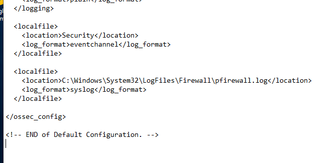

### Hình 3 – Minh họa Lab 6 – Network Scanning & Reconnaissance

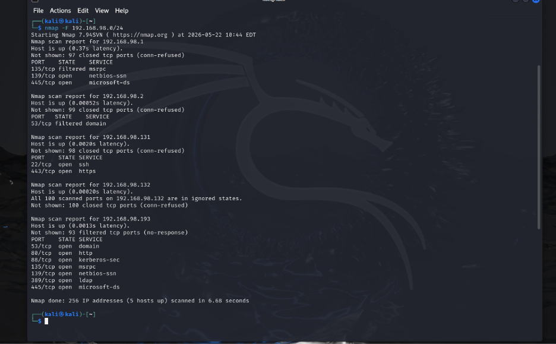

### Hình 4 – Minh họa Lab 6 – Network Scanning & Reconnaissance

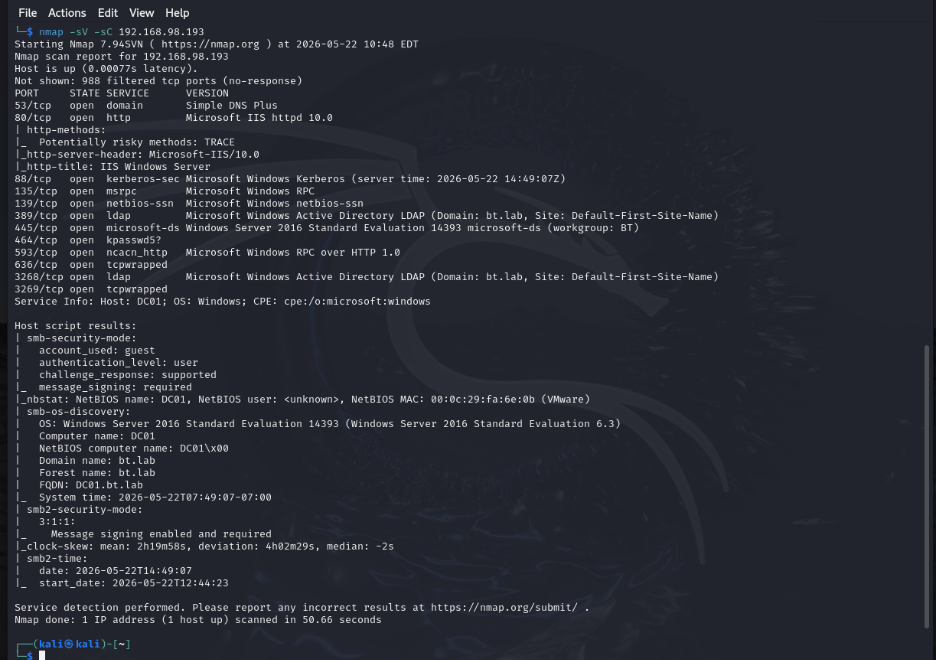

### Hình 5 – Minh họa Lab 6 – Network Scanning & Reconnaissance

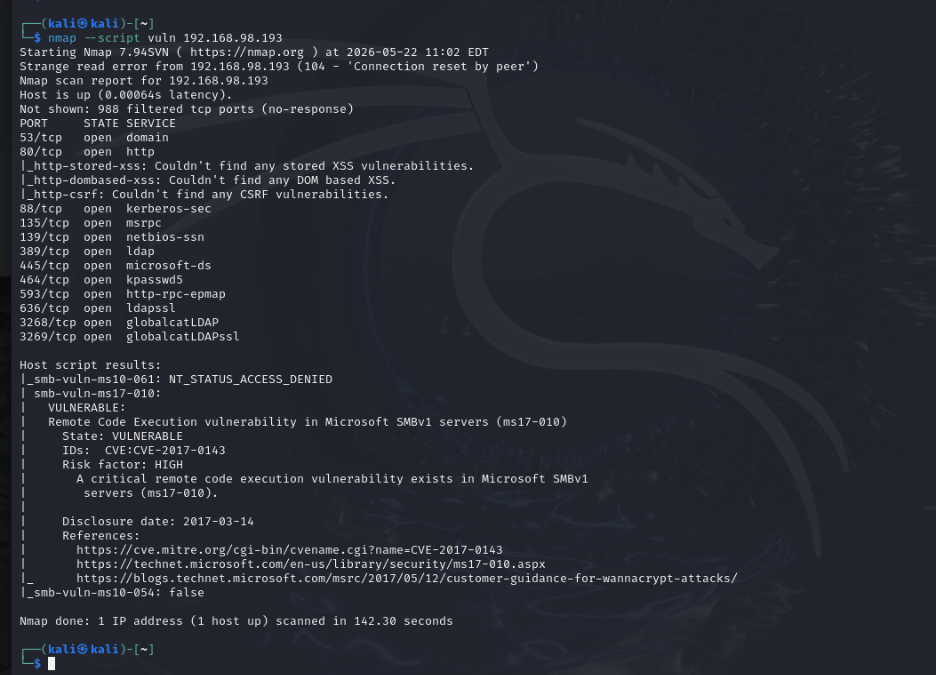

### Hình 6 – Minh họa Lab 6 – Network Scanning & Reconnaissance

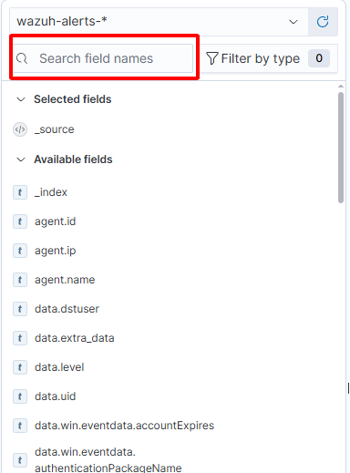

### Hình 7 – Minh họa Lab 6 – Network Scanning & Reconnaissance

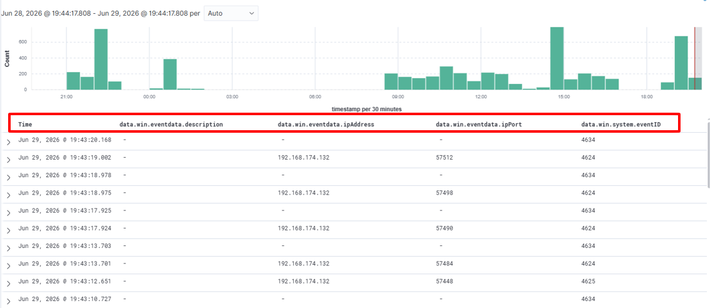

### Hình 8 – Minh họa Lab 6 – Network Scanning & Reconnaissance

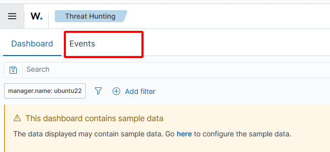

### Hình 9 – Minh họa Lab 6 – Network Scanning & Reconnaissance

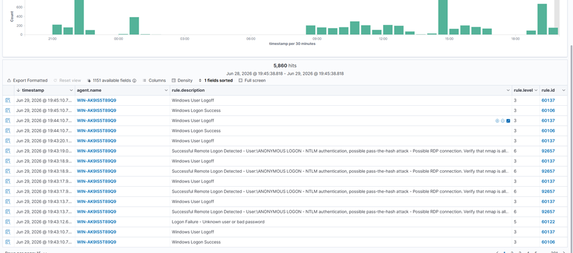

### Hình 10 – Minh họa Lab 6 – Network Scanning & Reconnaissance

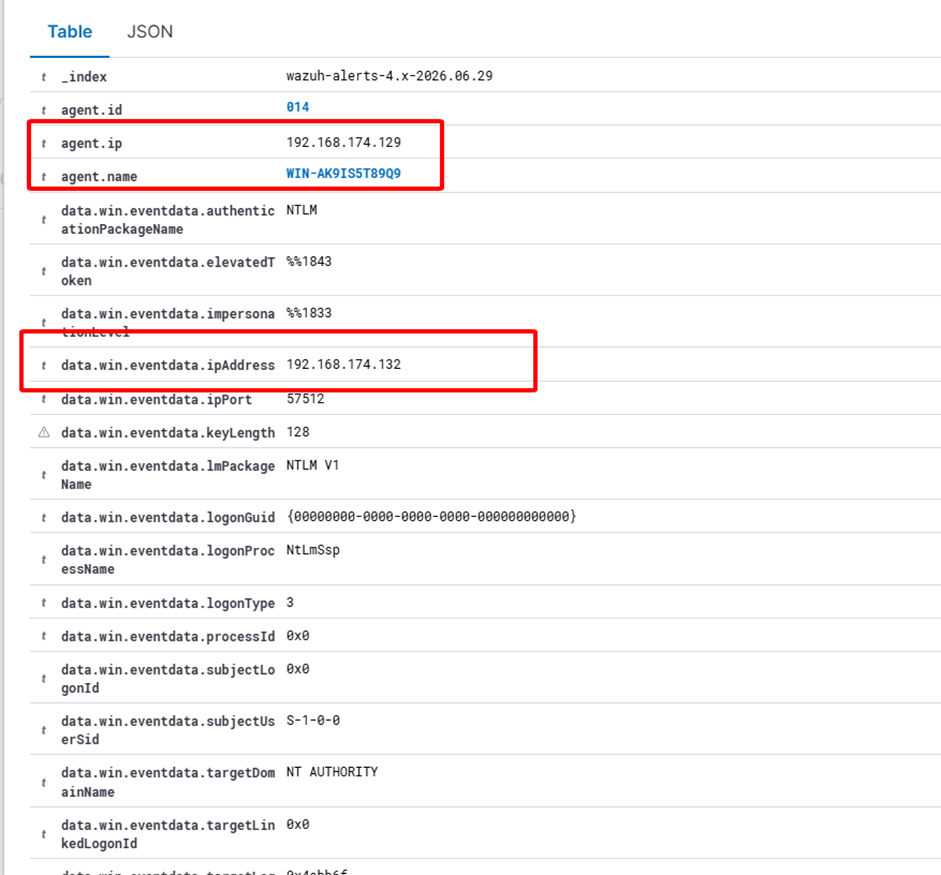

### Hình 11 – Minh họa Lab 6 – Network Scanning & Reconnaissance

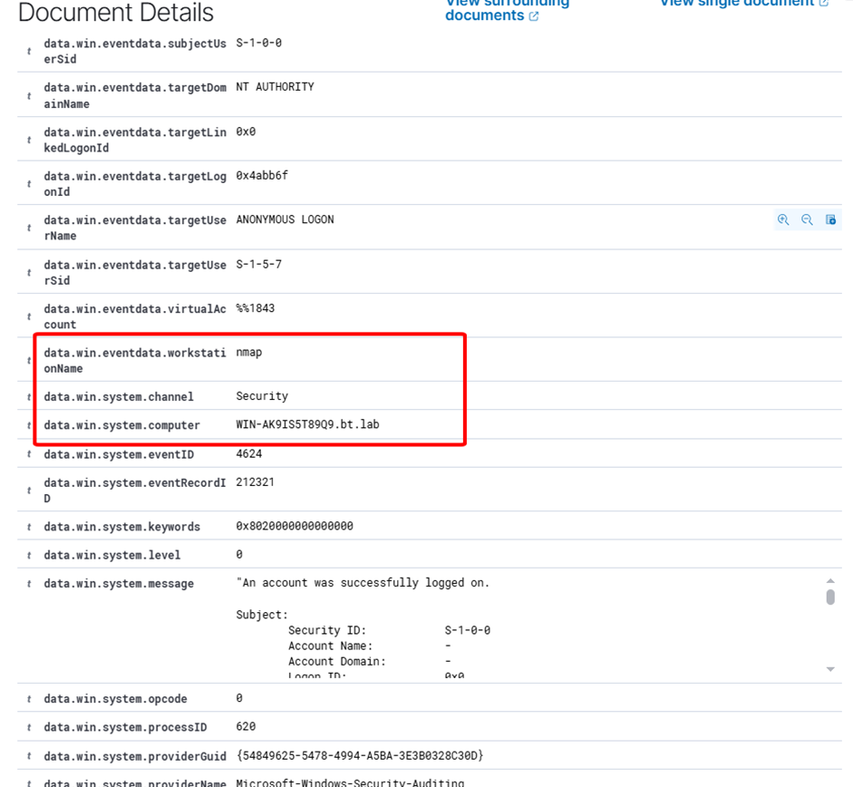

### Hình 12 – Minh họa Lab 6 – Network Scanning & Reconnaissance

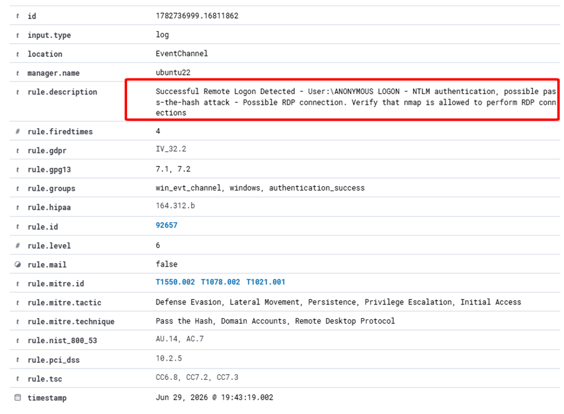

### Hình 13 – Minh họa Lab 6 – Network Scanning & Reconnaissance

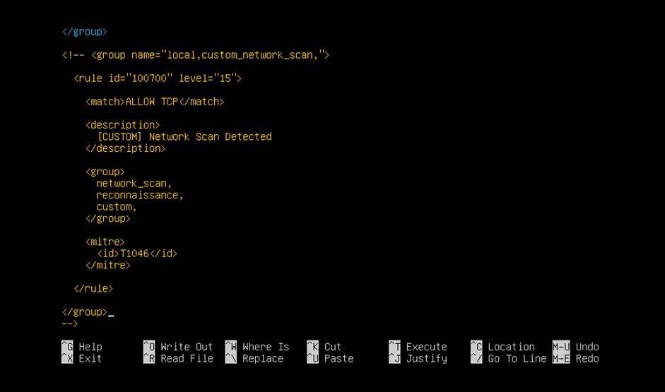

### Hình 14 – Minh họa Lab 6 – Network Scanning & Reconnaissance

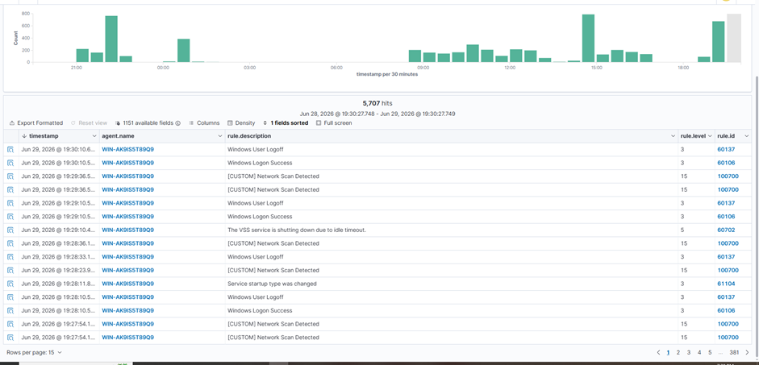

### Hình 15 – Minh họa Lab 6 – Network Scanning & Reconnaissance

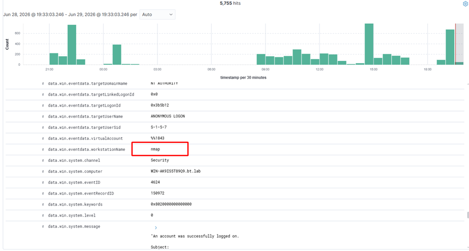

### Hình 16 – Minh họa Lab 6 – Network Scanning & Reconnaissance

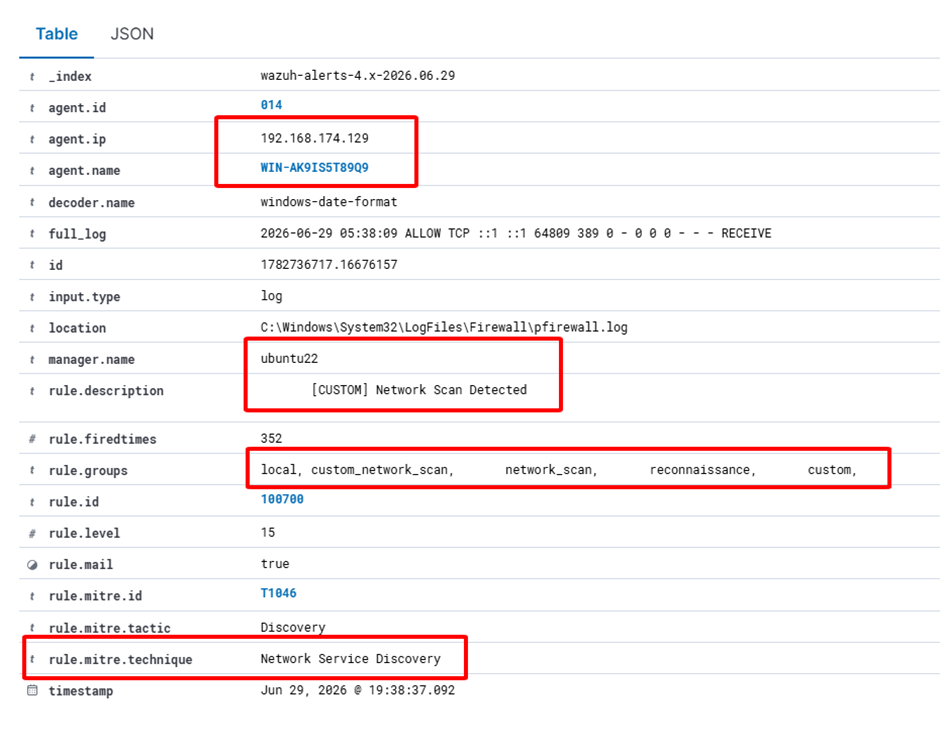

### Hình 17 – Minh họa Lab 6 – Network Scanning & Reconnaissance

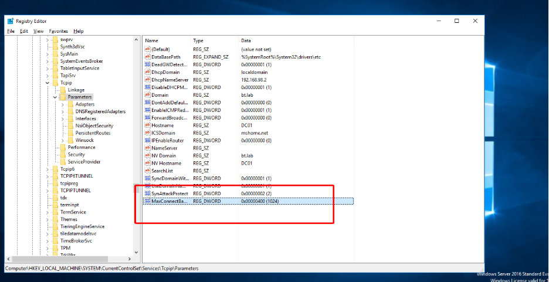

### Hình 18 – Minh họa Lab 6 – Network Scanning & Reconnaissance

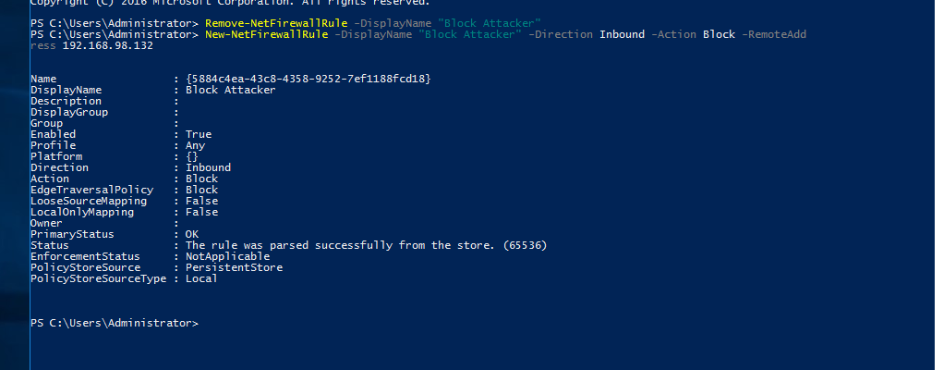

### Hình 19 – Minh họa Lab 6 – Network Scanning & Reconnaissance

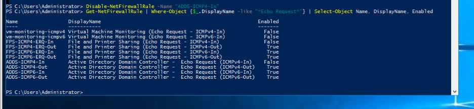

### Hình 20 – Minh họa Lab 6 – Network Scanning & Reconnaissance

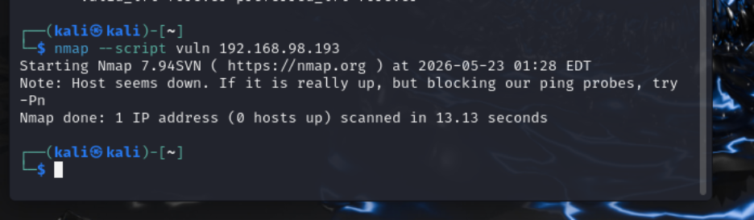

### Thông tin liên hệ/ghi chú cuối phần – Lab 6 – Network Scanning & Reconnaissance

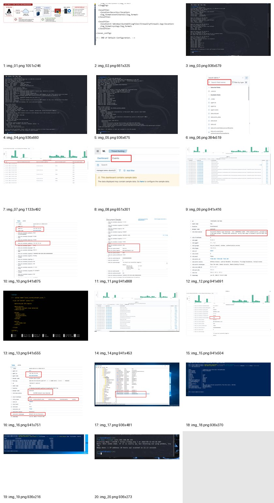
