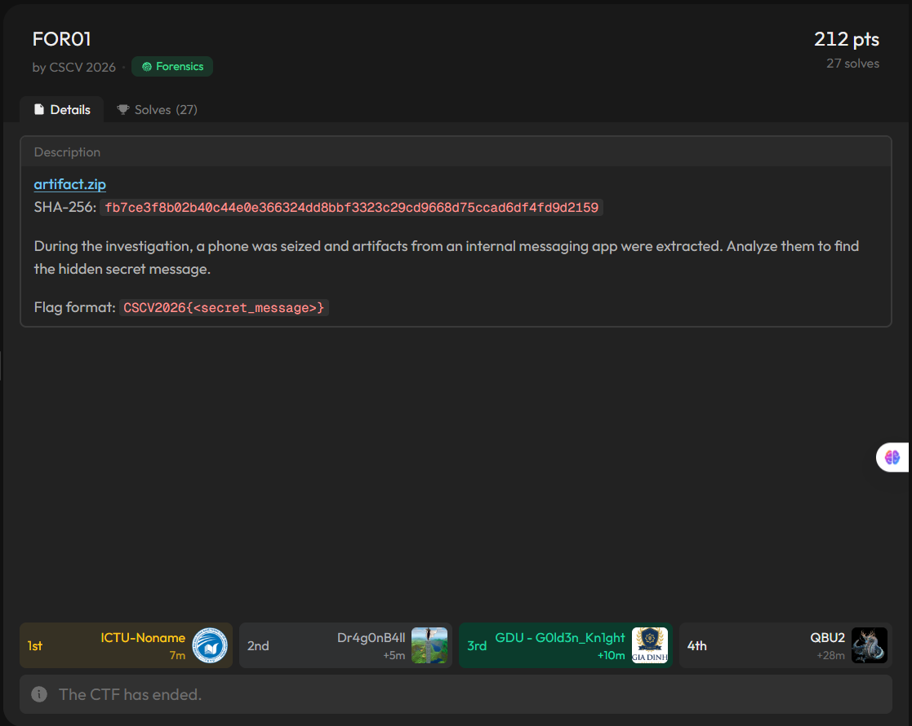
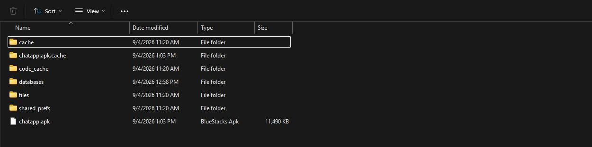
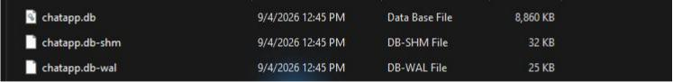
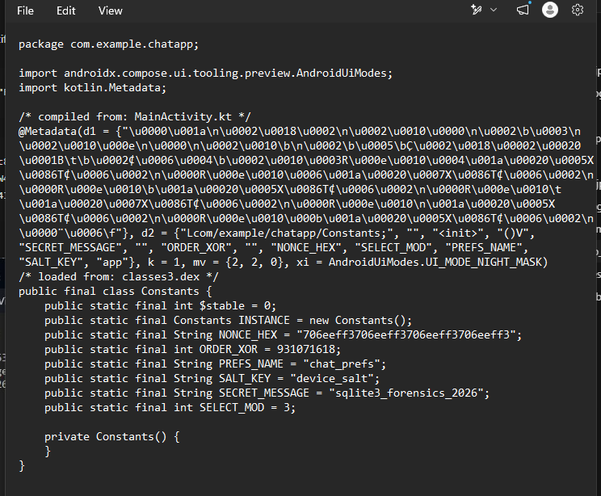
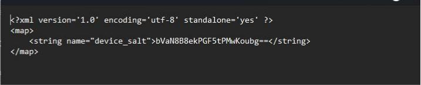

# CSCV 2026 Chung khảo — Tìm thông điệp ẩn trong ChatApp

> **Thể loại:** Mobile Forensics · SQLite WAL · Android APK · ChaCha20  
> **Mục tiêu:** tìm `secret_message` và nộp theo dạng `CSCV2026{<secret_message>}`.

## Bối cảnh và dữ liệu nhận được

Đề **FOR01** mô tả một chiếc điện thoại bị thu giữ trong quá trình điều tra. Dữ liệu của ứng dụng nhắn tin nội bộ đã được trích xuất; nhiệm vụ của mình là tìm thông điệp bí mật ẩn trong đó.



Thư mục `artifact` có `chatapp.apk`, cơ sở dữ liệu SQLite `databases/chatapp.db` cùng hai tệp đi kèm `chatapp.db-wal`, `chatapp.db-shm`, và cấu hình `shared_prefs/chat_prefs.xml`. Tệp WAL đặc biệt đáng chú ý: SQLite lưu các phiên bản trang cơ sở dữ liệu theo cơ chế ghi trước vào WAL, nên nó có thể giữ dấu vết mà truy vấn trạng thái hiện tại không còn cho thấy. [Tài liệu SQLite về WAL](https://www.sqlite.org/wal.html) giải thích cách bản ghi giao dịch được thêm vào tệp này và cách SQLite chọn phiên bản trang để đọc.





| Artifact | Kích thước | SHA-256 |
|---|---:|---|
| `chatapp.apk` | 11.764.975 byte | `65aa2173bbc269db1c03521f422870c31fc5b0c3a8f9c54dd60e6827a906926e` |
| `chatapp.db` | 9.072.640 byte | `ca8840dc01df7e78d2bbab5277aca5b7eefe4ae2865bfe94453a418917c3ec4f` |
| `chatapp.db-wal` | 24.752 byte | `8cd5fc0926b126ee6f9a4cbfa0fdd6f69bcb896f6d7454b0286874bf248ec4c4` |

Mình phân tích trên bản sao để không làm thay đổi artifact gốc. Điều này quan trọng với WAL: mở cơ sở dữ liệu cùng tệp `-wal` bằng một kết nối có quyền ghi có thể làm phát sinh checkpoint và thay đổi bản sao WAL. Script tái lập ở cuối bài chỉ đọc byte từ nguồn rồi dựng snapshot trong một tệp tạm.

## Dấu vết bất thường trong WAL

Truy vấn `chatapp.db` ở trạng thái hiện tại cho thấy hai bảng `threads` và `messages`, gồm **5 nhóm và 951 tin nhắn**. Các tin nhắn nhìn chung là hội thoại thường ngày; tìm trực tiếp flag hoặc thông điệp bí mật trong cột `body` không cho kết quả.

Mình chuyển sang đọc cấu trúc `chatapp.db-wal`. Header WAL dài 32 byte; với kích thước trang 4.096 byte, mỗi frame gồm header 24 byte và một trang dữ liệu 4.096 byte. Tệp dài 24.752 byte, đúng bằng `32 + 6 × (24 + 4.096)`, tức có **6 frame**. [Định dạng tệp SQLite](https://www.sqlite.org/fileformat2.html#walformat) mô tả cấu trúc header và frame này.

```python
import struct

wal = open("databases/chatapp.db-wal", "rb").read()
page_size = struct.unpack_from(">I", wal, 8)[0]  # 4096
for i in range((len(wal) - 32) // (24 + page_size)):
    offset = 32 + i * (24 + page_size)
    page_no, db_pages = struct.unpack_from(">II", wal, offset)
    print(i, page_no, db_pages)
```

```text
0 2215 2215
1 3    0
2 2166 0
3 2214 0
4 2215 2215
5 2215 2215
```

Trang **2215** xuất hiện ở frame 0, 4 và 5. Đây là lý do để so sánh các phiên bản của cùng một trang. Mình lấy 4.096 byte dữ liệu của từng frame, thay vào đúng vị trí trang 2215 trên **bản sao** `chatapp.db`, rồi truy vấn bản dựng lại bằng SQLite.

| Phiên bản trang 2215 | Số tin nhắn truy vấn được | ID 888–919 |
|---|---:|---|
| Frame 0 | 919 | 32 dòng có `body` dạng Base64 |
| Frame 4 | 887 | Không còn các dòng này |
| Frame 5 / DB hiện tại | 951 | ID được dùng lại với hội thoại bình thường |

Ví dụ, ở frame 0, ID **888** thuộc nhóm `ATTT Group`, do **Quân** gửi lúc **02/09/2026 11:00:07 UTC+7**, có `body = Yw==`. Giải Base64 được đúng một byte `0x63`. Trong DB hiện tại, chính ID 888 lại có nội dung “user đó đổi mật khẩu chưa, ai confirm giúp”. ID 889 và 890 đều chứa `wg==` trong frame 0, mỗi chuỗi cho byte `0xc2`. Sự thay đổi đồng loạt của 32 dòng cho thấy bản cũ trong WAL mới là dấu vết cần theo tiếp.

Mình trích toàn bộ ID **888–919** thành [bảng đối chiếu](recovered_messages.csv). Nếu chỉ ghép 32 byte theo ID tăng dần thì thu được chuỗi nhị phân sau, chưa phải bản rõ:

```text
63c2c25fc84999828d79c52b5ff343eba9a20132af2c552b3e7f8cacfbc74713
```

## Tìm quy tắc chọn và thứ tự byte

Để hiểu 32 byte này, mình xem `chatapp.apk`. Lớp `com.example.chatapp.Constants` chứa các giá trị:



```text
SECRET_MESSAGE = "sqlite3_forensics_2026"
SELECT_MOD     = 3
ORDER_XOR      = 931071618  # 0x377f0682
NONCE_HEX      = "706eeff3706eeff3706eeff3706eeff3"
```

`ORDER_XOR` bằng magic `0x377f0682` ở đầu WAL. Giá trị này vừa củng cố hướng kiểm tra WAL, vừa gợi ý dùng XOR khi xử lý thứ tự. `SELECT_MOD` cho thấy cần chọn một phần bản ghi thay vì giải cả 32 byte. Phần chưa rõ là áp dụng chúng lên ID hay timestamp; mình kiểm tra các cách tương ứng và dùng kết quả giải mã có nghĩa để xác nhận.

Quy tắc khớp là **giữ các dòng có `(timestamp ^ ORDER_XOR) % SELECT_MOD == 0`**, rồi **sắp tăng dần theo `timestamp ^ ORDER_XOR`**. Có 16 dòng được chọn, với ID theo đúng thứ tự:

```text
888, 891, 892, 895, 894, 901, 904, 902, 900, 907, 905, 910, 909, 913, 912, 915
```

Sau khi giải Base64 từng `body` và ghép theo thứ tự đó, ciphertext là:

```text
635fc88299f3a9435f32a2552c7f3eac
```

Chú ý ID **895 đứng trước 894** trong chuỗi đã sắp; ghép theo ID tăng dần sẽ cho ciphertext khác. Đây là bước dễ làm sai nhất của bài.

## Giải mã thông điệp

Tệp `shared_prefs/chat_prefs.xml` có giá trị `device_salt = bVaN8B8ekPGF5tPMwKoubg==`. Giải Base64 được 16 byte `6d568df01f1e90f185e6d3ccc0aa2e6e`. Mình lấy SHA-256 của `SECRET_MESSAGE` ở dạng UTF-8 **nối trực tiếp** với salt này để tạo khóa 32 byte:



```text
SHA256(b"sqlite3_forensics_2026" + device_salt)
= a8dab43b712b4880894ab4bc0515a8748b81368c5f44d4dd43067c9172cbe6c6
```

Dùng khóa đó, nonce 16 byte từ `NONCE_HEX`, và ChaCha20 để giải mã ciphertext. Mã dưới đây là phần cốt lõi; [script đầy đủ](solve.py) còn tự dựng snapshot từ WAL:

```python
import base64
import hashlib
from cryptography.hazmat.primitives.ciphers import Cipher, algorithms

salt = base64.b64decode("bVaN8B8ekPGF5tPMwKoubg==")
key = hashlib.sha256(b"sqlite3_forensics_2026" + salt).digest()
nonce = bytes.fromhex("706eeff3706eeff3706eeff3706eeff3")
ciphertext = bytes.fromhex("635fc88299f3a9435f32a2552c7f3eac")

message = Cipher(algorithms.ChaCha20(key, nonce), mode=None) \
    .decryptor().update(ciphertext).decode("ascii")
print(message)
```

```text
W4l_1s_s0_c00l!!
```

Thư viện `cryptography` nhận khóa ChaCha20 dài 32 byte và tham số nonce dài 16 byte cho API này; vì vậy cần truyền đúng toàn bộ `NONCE_HEX`, không cắt còn 12 byte như ở một số API khác. [Tài liệu `cryptography` về ChaCha20](https://cryptography.io/en/latest/hazmat/primitives/symmetric-encryption/#cryptography.hazmat.primitives.ciphers.algorithms.ChaCha20).

Để kiểm tra từ artifact gốc, chạy:

```powershell
python solve.py "F:\CSCV\CHUNG KHẢO\artifact"
```

```text
Ciphertext: 635fc88299f3a9435f32a2552c7f3eac
Secret message: W4l_1s_s0_c00l!!
```


> **For1 Flag :** `CSCV2026{W4l_1s_s0_c00l!!}`
